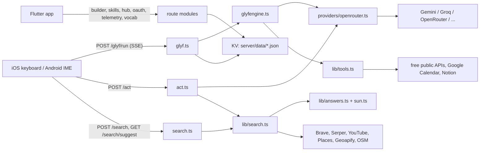

# Glyf Backend (`server/`)

The complete reference for the Glyf backend: what exists, how it works, every decision and why, what was tried and rejected, current status, and what is still pending.

- Last written: 2026-09-16. All dates and times are India Standard Time (IST).
- Written from: the code in `server/`, `shared/contracts/`, `ci/`, `SPEC.md`, `README.md`, the gate docs in `docs/`, the assistant's working notes, and the exported chat history in `docs/history/`.
- "Verified" in this doc means checked against the code while writing. Nothing was run while writing it (no server start, no tests). Where a fact comes only from chat history or notes, the text says so.
- `server/.env` was deliberately not opened. This doc never contains secret values, only variable names.

---

## Contents

1. [At a glance](#1-at-a-glance)
2. [Running it locally](#2-running-it-locally)
3. [Architecture](#3-architecture)
4. [Endpoint reference](#4-endpoint-reference)
5. [AI layer](#5-ai-layer)
6. [Search suite](#6-search-suite)
7. [Keyless tool registry](#7-keyless-tool-registry)
8. [Connectors and the OAuth broker](#8-connectors-and-the-oauth-broker)
9. [Wallet and crypto (M8)](#9-wallet-and-crypto-m8)
10. [Security rules and safeguards](#10-security-rules-and-safeguards)
11. [Environment variables](#11-environment-variables)
12. [Tests](#12-tests)
13. [Deployment](#13-deployment)
14. [Extending the backend](#14-extending-the-backend)
15. [Decision log](#15-decision-log)
16. [Known issues](#16-known-issues)
17. [Pending work and what Arpit needs to provide](#17-pending-work-and-what-arpit-needs-to-provide)
18. [Relationship to the website](#18-relationship-to-the-website)
19. [Sources](#19-sources)

---

## 1. At a glance

Glyf is an AI keyboard for iPhone and Android. The keyboards (native Swift on iOS, native Kotlin on Android) and the Flutter container app call this backend for everything that needs a network, a model, or a secret: AI runs, the hold-space "act" feature, the Google/YouTube/Maps search suite, keyless API tools, OAuth connectors, the Skills hub, telemetry and metering.

| Item | Value |
|---|---|
| Stack | Node 20+, Fastify 5, TypeScript 5 (ESM, `NodeNext`), zod 3, dotenv |
| Runner | `tsx` (runs TypeScript directly, no build step needed) |
| Tests | vitest 2, 8 files, 90 test cases (static count) |
| Entry point | `server/src/index.ts` (`buildApp()` registers all routes) |
| Port | `8787` by default (`PORT`), listens on `0.0.0.0` |
| Storage | A `KV` interface: JSON files in `server/data/` on a laptop, Postgres (`PostgresKV`, Neon over HTTP) wherever `DATABASE_URL` is set — which is what production runs (`GLYF_STORE=postgres` makes a missing URL fail at boot instead of falling back to files) |
| AI | Any OpenAI-compatible chat API: OpenRouter, Gemini, Groq, Mistral, Inception, Cerebras, chosen by an ordered fallback chain |
| Mock mode | `MOCK_AI=true` makes every model, search and tool call deterministic and offline |
| Public origin | `https://api.tryglyf.com` |
| Deployed? | **Yes, since 2026-09-18** — Railway, Singapore region (`x-railway-edge: sin1`), next to the Neon database. Every push to `main` redeploys, so a push is a deploy. See [section 13](#13-deployment) |
| Repo | Private monorepo `https://github.com/The-x-35/glyf` (first push 2026-09-16). `server/.env` and `server/data/` are not committed |
| Package version | `glyf-server` 0.2.0 (`server/package.json`) |

The website (`site/`, tryglyf.com on Vercel) does **not** use this server. Its waitlist writes to Neon Postgres directly. See [section 18](#18-relationship-to-the-website).

---

## 2. Running it locally

### Commands

All commands run from `server/`. Scripts come from `server/package.json`.

| Command | What it does |
|---|---|
| `npm install` | Install dependencies (first time only) |
| `npm run dev` | `tsx watch src/index.ts`. Starts the server and restarts on file changes |
| `npm start` | `tsx src/index.ts`. Starts the server once, no watch |
| `npm test` | `vitest run`. Runs all 8 test files once |
| `npm run typecheck` | `tsc --noEmit` |
| `npm run build` | `tsc -p tsconfig.json` into `server/dist/`. See [known issue 9](#16-known-issues): the build does not copy the registry JSON |

Environment setup:

1. Copy `server/.env.example` to `server/.env` (both paths are covered by the root `.gitignore` rule `.env`, `.env.*`, `!.env.example`).
2. For offline work keep `MOCK_AI=true`. No keys are needed.
3. For live AI set `MOCK_AI=false` and at least one model key (`GEMINI_API_KEY`, `GROQ_API_KEY` or `OPENROUTER_API_KEY`). Startup throws if live mode has no model key (`assertServerSecrets()` in `server/src/env.ts`).
4. Remove or comment out `OAUTH_REDIRECT_BASE` for local work. The example file sets it to the production URL, which would send OAuth callbacks to production (see [known issue 14](#16-known-issues)).

`.env` is loaded by `dotenv` from `server/.env` (path resolved relative to `src/`). dotenv does not override variables already set in the shell, so `MOCK_AI=true npm start` forces mock mode even when `.env` says `false`.

Health check: `curl http://127.0.0.1:8787/health` returns `{ ok, mockAI, fastModels, hasOpenRouterKey }`.

### How clients reach a local server

| Client | Debug build backend | Release build backend | Where it is set |
|---|---|---|---|
| iOS keyboard extension | `http://127.0.0.1:8787` | `https://api.tryglyf.com` | `GlyfSettings.defaultBackendURL` / `productionBackend` in `app/ios/GlyfKeyboard/Engine/SettingsStore.swift` |
| Flutter app | `http://127.0.0.1:8787` (fallback when shared settings have no URL) | `https://api.tryglyf.com` | `app/lib/core/glyf_api.dart` |
| Android app and IME | `http://10.0.2.2:8787` (the emulator's alias for the Mac) | `https://api.tryglyf.com` | `PRODUCTION_BACKEND` in `app/android/app/src/main/kotlin/com/demo/glyf/store/Stores.kt` |

The backend URL is persisted in shared settings (`backendURL`). Both native stores "productionize" it on load:

- A release build rewrites any stored dev URL (`127.0.0.1`, `localhost`, `10.0.2.2`, `0.0.0.0`) to production, so a shipped build can never point at a laptop.
- An iOS debug build rewrites a stored production URL back to the dev URL. This was added on 2026-09-14 after the simulator kept a persisted production URL and every search failed with a TLS error, because `api.tryglyf.com` did not exist yet (it went live 2026-09-18). The same investigation found that Swift `#if DEBUG` was dead in the keyboard target (it needs `SWIFT_ACTIVE_COMPILATION_CONDITIONS`), so debug keyboards had been silently calling production.

A physical phone cannot reach `127.0.0.1` on the Mac. Until the server is deployed, device testing of AI features needs the stored `backendURL` changed to the Mac's LAN address or a tunnel. This was never set up in the notes.

### Working habits recorded in the history

- **Restart after adding routes.** A server process started before new routes were added answers `/health` fine but returns 404 for the new routes (SPIKES finding 23, 2026-09-12).
- **UI test suites need mock mode.** The iOS UI gate suites expect `MOCK_AI=true npm start` on `127.0.0.1:8787`. Restart in live mode afterwards. On 2026-09-14 the mock server was left running and Arpit saw fixture results in the keyboard ("you have hard coded results in ios"). Mock fixtures must never reach a user-facing run.
- **Resetting QA data.** Hub and skills testing writes real rows to `server/data/`. To reset, stop the server first (FileKV caches collections in memory and rewrites the whole file on the next write), then clear `accounts.json`, `installs.json`, `skill-installs.json` and `skill-installs-by.json`.
- A local preview launch configuration named `glyf-server` runs `npm run start` in `server/` on port 8787.

---

## 3. Architecture

### File map

```
server/
├── package.json, package-lock.json, tsconfig.json
├── .env.example            documented variable names (no values)
├── .gitignore              ignores data/
├── data/                   FileKV JSON collections (dev storage, not committed)
├── src/
│   ├── index.ts            buildApp(): creates KV, meter, library; registers every route module
│   ├── env.ts              loads server/.env; typed env object; assertServerSecrets()
│   ├── providers/
│   │   └── openrouter.ts   model router: provider prefixes, request options, SSE streaming,
│   │                       rate-limit cooldown, classifier-verdict gate, mock stream
│   ├── routes/
│   │   ├── health.ts       GET /health
│   │   ├── meter.ts        GET /meter/:deviceId
│   │   ├── glyf.ts         GET /glyf/catalog, POST /glyf/run (SSE)
│   │   ├── act.ts          POST /act, GET /p/:id
│   │   ├── vocab.ts        POST /vocab/generate
│   │   ├── builder.ts      POST /builder/generate, /builder/test; POST/GET/DELETE /glyfs
│   │   ├── hub.ts          /skills, /skills/creators, /skills/get, /hub/*, /account/*
│   │   ├── search.ts       POST /search; GET /search/suggest, /search/photo, /search/staticmap, /search/status
│   │   ├── rates.ts        GET /rates/fiat (ECB per dollar), GET /rates/crypto?symbols= (Jupiter verified tokens)
│   │   ├── tools.ts        POST /tools/run
│   │   ├── connector.ts    OAuth broker, /connectors/*, mock calendar
│   │   ├── media.ts        GET /media/config, /media/emoji-stickers (GIFs and stickers)
│   │   ├── telemetry.ts    POST /telemetry, GET /telemetry/funnel
│   │   └── waitlist.ts     POST /waitlist, GET /waitlist/count (legacy)
│   ├── lib/
│   │   ├── glyfengine.ts   registry loader + step engine (llm, format, if, map, tool, ask)
│   │   ├── userglyfs.ts    GlyfLibrary: user glyfs, hub, installs, moderation
│   │   ├── skills.ts       Skills list, derived categories, creators, official install counts
│   │   ├── tools.ts        tool registry loader, per-tool rate limit, all tool executors, mock outputs
│   │   ├── act.ts          hold-space intent planner and executor
│   │   ├── pages.ts        live mini-app pages (create, get, render HTML)
│   │   ├── search.ts       search engine: web, YouTube, maps provider chains; nearby; provider status
│   │   ├── answers.ts      instant answers: math, sunset, time, weather, currency, Wikipedia
│   │   ├── sun.ts          sunrise, sunset, golden hour (NOAA equation), clock formatting
│   │   ├── suggest.ts      landing state: trending searches, popular or liked videos, nearby places
│   │   ├── searchcards.ts  card contract shared with Swift and Kotlin; composeInsert()
│   │   ├── vocab.ts        AI vocabulary pack generation and cleaning
│   │   ├── meter.ts        plans, planCap(), in-memory daily meter
│   │   ├── cache.ts        TTLCache (sha256 keys, TTL, max entries)
│   │   └── store.ts        KV interface, FileKV, MemoryKV, defaultKV()
│   ├── registry/
│   │   ├── glyfs/*.json    23 shipped glyf definitions
│   │   └── tools/*.json    30 tool definitions
│   └── schemas/
│       ├── glyfdef.ts      zod schema for glyf definitions and run requests
│       └── contracts.generated.ts  zod Intent/Result, generated from shared/contracts (not imported yet)
└── test/                   8 vitest files (see section 12)
```

### Request flow



### Identity: the device id

There are no user accounts yet. Every client generates a random lowercase UUID once (`deviceId` in shared settings) and sends it with requests. The server keys everything to it: meter counts, user glyfs, hub ownership, installs, OAuth connections, display names, telemetry days.

Consequences:

- The device id works as a bearer credential. Anyone who knows it can list that device's glyfs, publish or delete them, or disconnect its connectors. The hub list strips owner ids for this reason (fixed 2026-09-15).
- Data survives app updates because the settings file survives updates (verified experimentally on 2026-09-13). An uninstall or a bundle id change creates a new device id and orphans server-side data.
- Accounts are planned: Arpit decided on 2026-09-15 that the app will get a sign-up step backed by the same Neon database as the waitlist, with Google permissions requested only when a feature needs them. Nothing of this exists in the server yet.

### Storage (`server/src/lib/store.ts`)

`KV` is a four-method interface (`get`, `put`, `del`, `list`) over named collections.

- `FileKV` (default): each collection is one JSON file in `server/data/`. Loaded lazily into memory, the whole file is rewritten synchronously on every `put` or `del`. A corrupt file starts empty in memory and the original stays on disk until the next write overwrites it.
- `MemoryKV`: used when `NODE_ENV=test` (vitest sets this by default).
- The code comment says a Postgres driver will drop in behind the same interface for deploy (SPEC §2 pins Postgres in production). It has not been written.

Collections:

| Collection | Key | Value | Written by |
|---|---|---|---|
| `userglyfs` | glyf id (`user.<8 hex>`) | `{ def, ownerId, createdAt, updatedAt, published }` | `POST /glyfs`, publish |
| `hub` | glyf id | `{ def, ownerId, ownerName, installs, publishedAt }` | `POST /hub/publish`, installs |
| `installs` | `<deviceId>:<glyfId>` | `{ version, discloses, at }` | `/hub/install`, `/skills/get` (community) |
| `accounts` | deviceId | `{ displayName }` | `POST /account/name` |
| `skill-installs` | shipped glyf id | install count (number) | `/skills/get` (official) |
| `skill-installs-by` | `<deviceId>:<glyfId>` | `true` | `/skills/get` (official) |
| `connections` | `<deviceId>:<provider>` | `{ provider, scopes, email, access_token, refresh_token, expires_at, connectedAt }` | OAuth callbacks |
| `pages` | 12-char random id | `{ title, places, createdAt }` | `POST /act` (places intent) |
| `telemetry` | `<YYYY-MM-DD>:<event>` | `{ count }` | `POST /telemetry` |
| `devices` | deviceId | `{ days: string[] }` (last 60 active days) | `POST /telemetry` |
| `waitlist` | base64url of the email | `{ email, at }` | `POST /waitlist` (legacy) |

At the time of writing, `server/data/` holds dev files for most collections (entry counts only were checked: 29 user glyfs, 22 telemetry counters, 10 devices, 1 waitlist row, the rest empty). There is no `connections.json` or `pages.json`, which is consistent with no OAuth connection ever having been made. OAuth tokens and waitlist emails are personal data: never commit or share these files.

### In-memory state (lost on restart)

| State | Where | Effect of a restart |
|---|---|---|
| Daily run counts | `MemoryMeter` in `lib/meter.ts` | Everyone's free runs reset |
| Run output cache (24 h) | `TTLCache` in `routes/glyf.ts` | Cache cleared |
| Search cache (10 min) and suggest cache (30 min) | `lib/search.ts`, `lib/suggest.ts` | Cache cleared |
| Model cooldowns | `coolingUntil` in `providers/openrouter.ts` | Rate-limited models are retried |
| OAuth pending states (10 min) | `pending` map in `routes/connector.ts` | In-flight sign-ins fail |
| Per-tool request timestamps | `hits` map in `lib/tools.ts` | Tool rate limits reset |
| Nominatim request queue | `nominatimGate` in `lib/search.ts` | Queue reset |

None of this works across multiple server instances. A deployment must run one instance until the meter, pending states and caches move to shared storage.

### Logging and privacy in logs

- Fastify logger at `info`, with `disableRequestLogging: true`, so URLs and query strings (which can carry coordinates) are not logged per request.
- Routes log events and timings only (SPEC §12): glyf id, device id, plan, input length, duration, intent, provider, card count. Never the typed text, the query, the vocabulary description or the model output. One exception: failure logs include raw error messages, and a few tool errors embed user input ([known issue 28](#16-known-issues)).
- Bad-request logs record which zod field failed (`issues`), never the body.
- SPEC §8.4 asked for per-call latency and token counts in dev logs. Token counts are not logged.

---

## 4. Endpoint reference

### 4.1 All routes

"Metered" means the request consumes one run from the device's daily cap. "Used by" comes from searching the client source for the path; "none found" means no current caller was found.

| # | Method | Path | Purpose | Metered | File | Used by |
|---|---|---|---|---|---|---|
| 1 | GET | `/health` | Liveness and config presence | No | `routes/health.ts` | Flutter app |
| 2 | GET | `/meter/:deviceId` | Remaining runs today | No | `routes/meter.ts` | iOS keyboard, Flutter app |
| 3 | GET | `/glyf/catalog` | Shipped glyf list | No | `routes/glyf.ts` | Flutter app |
| 4 | POST | `/glyf/run` | Run a glyf, streamed over SSE | Yes | `routes/glyf.ts` | iOS keyboard, Android IME, Flutter app |
| 5 | POST | `/act` | Hold space: act on typed text | Yes | `routes/act.ts` | iOS keyboard, Android IME |
| 6 | GET | `/p/:id` | Live mini-app page (HTML) | No | `routes/act.ts` | Message recipients in a browser |
| 7 | POST | `/vocab/generate` | AI vocabulary pack | Yes | `routes/vocab.ts` | Flutter app |
| 8 | POST | `/builder/generate` | Plain English to glyf definition | **No** | `routes/builder.ts` | Flutter app |
| 9 | POST | `/builder/test` | Test-run an unsaved definition | **No** | `routes/builder.ts` | Flutter app |
| 10 | POST | `/glyfs` | Save a user glyf | No | `routes/builder.ts` | Flutter app |
| 11 | GET | `/glyfs?deviceId=` | List the device's glyfs | No | `routes/builder.ts` | Flutter app |
| 12 | DELETE | `/glyfs/:id?deviceId=` | Delete a user glyf | No | `routes/builder.ts` | Flutter app |
| 13 | GET | `/skills?category=&q=` | Skills browser list | No | `routes/hub.ts` | Flutter app |
| 14 | GET | `/skills/creators` | Creators with real counts | No | `routes/hub.ts` | Flutter app |
| 15 | POST | `/skills/get` | Add a skill (official or community) | No | `routes/hub.ts` | Flutter app |
| 16 | GET | `/hub/list` | Published community glyfs | No | `routes/hub.ts` | None found (superseded by `/skills`) |
| 17 | POST | `/hub/publish` | Publish own glyf | No | `routes/hub.ts` | Flutter app |
| 18 | POST | `/hub/install` | Install a community glyf | No | `routes/hub.ts` | None found (superseded by `/skills/get`) |
| 19 | POST | `/account/name` | Set display name | No | `routes/hub.ts` | Flutter app |
| 20 | GET | `/account/:deviceId/creator` | Creator stats | No | `routes/hub.ts` | Flutter app |
| 21 | POST | `/search` | Typed search cards | No | `routes/search.ts` | iOS keyboard, Android IME |
| 22 | GET | `/search/suggest` | Landing state before typing | No | `routes/search.ts` | iOS keyboard, Android IME |
| 23 | GET | `/search/photo?ref=` | Google Places photo proxy | No | `routes/search.ts` | Card thumbnails (relative URLs; Android prefixes its backend URL, iOS handling not verified) |
| 24 | GET | `/search/staticmap?lat=&lon=` | Geoapify static map proxy | No | `routes/search.ts` | Android IME act map card |
| 25 | GET | `/search/status` | Which search providers are live | No | `routes/search.ts` | None found (diagnostic) |
| 25a | GET | `/rates/fiat` | ECB rates per dollar (Frankfurter, cached 1h) for the strip's money chip | Session | `routes/rates.ts` | iOS keyboard, Android IME (`RatesStore`) |
| 25b | GET | `/rates/crypto?symbols=SOL,USDC` | Dollar price of the verified Solana token behind a ticker (Jupiter, cached 60s) | Session | `routes/rates.ts` | iOS keyboard, Android IME (cashtags) |
| 26 | POST | `/tools/run` | Run one keyless tool | No | `routes/tools.ts` | Client methods exist in both keyboards, no current call sites found |
| 27 | GET | `/connectors/status?deviceId=` | Provider configured/connected state | No | `routes/connector.ts` | Flutter app |
| 28 | GET | `/oauth/google/start?deviceId=&scopes=` | Google consent URL | No | `routes/connector.ts` | Flutter app |
| 29 | GET | `/oauth/google/callback` | Google redirect target | No | `routes/connector.ts` | Google |
| 30 | GET | `/oauth/:provider/start?deviceId=` | Consent URL for other providers | No | `routes/connector.ts` | Flutter app |
| 31 | GET | `/oauth/:provider/callback` | Redirect target for other providers | No | `routes/connector.ts` | The provider |
| 32 | POST | `/connectors/disconnect` | Delete a stored connection | No | `routes/connector.ts` | Flutter app |
| 33 | GET | `/connector/mockcal/events?q=` | Demo calendar events | No | `routes/connector.ts` | iOS keyboard ConnectorSurface |
| 34 | GET | `/connector/mockcal/month?year=&month=` | Demo month grid | No | `routes/connector.ts` | iOS keyboard ConnectorSurface |
| 35 | GET | `/media/config`, `/media/emoji-stickers?q=&page=` | KLIPY key for the phone; Noto animated emoji stickers | Yes | `routes/media.ts` | iOS emoji board (`MediaClient.swift`) |
| 35a | POST | `/meetings/new` | A call link when Google isn't connected: a Daily room with `DAILY_API_KEY`, else Jitsi Meet | Session | `routes/scheduling.ts` | iOS keyboard, Android IME (calendar, Meet link key) |
| 35b | GET | `/scheduling/slots?link=&date=&days=&tz=` | Open times on a Cal.com page, each with a link that opens on it; a Calendly link comes back as its page only | Session | `routes/scheduling.ts` | iOS keyboard, Android IME (Book a time) |
| 35c | POST | `/scheduling/book` | Books a Cal.com time for an attendee and guests; Cal.com emails the invites | Session | `routes/scheduling.ts` | iOS keyboard, Android IME (Book a time) |
| 36 | POST | `/telemetry` | Event batch sink | No | `routes/telemetry.ts` | Flutter app |
| 37 | GET | `/telemetry/funnel` | Aggregated counts | No | `routes/telemetry.ts` | None found |
| 38 | POST | `/waitlist` | Legacy waitlist signup | No | `routes/waitlist.ts` | None (the site now uses Neon) |
| 39 | GET | `/waitlist/count` | Legacy waitlist count | No | `routes/waitlist.ts` | None |

Every route except the open paths in `lib/protect.ts` (`/health`, `/auth/*`, `/waitlist`, `/p/*`, OAuth callbacks, `/connectors/status`) needs a Glyf session (`Authorization: Bearer`). Rate limits count **per account** once the session is verified (150 requests a minute across a person's phones); the per-address counts are only abuse ceilings (600 a minute, 60 a minute on the open paths), because phones on carrier-grade NAT and offices share one address and a tight per-IP count there would take the keyboard away from everyone at once. Fastify's default JSON body limit applies.

### 4.2 Health and meter

**`GET /health`**
- Response: `{ ok: true, mockAI: boolean, fastModels: string[], hasOpenRouterKey: boolean }`.
- Only presence booleans, never secrets (SPEC §1.6). A test asserts no OpenRouter-shaped key appears in the body.
- It reports only the OpenRouter key, not Gemini or Groq keys.

**`GET /meter/:deviceId`**
- Response: `{ remaining: number, plan: "free" | "plus" | "max", perDay: number }`: what is left today, on the plan the server is enforcing (the account's row when signed in, free for a phone alone). Capped at 9999.
- Powers the keyboard's remaining-runs chip and the app's plan card, so the two read the same numbers.

**`POST /me/plan`** (`routes/me.ts`)
- Body `{ plan: "free" | "plus" | "max" }`. The paywall's pick. Changes the account's row only when `PLAN_SELF_SERVE=true` (development and TestFlight); otherwise 403 "Plans arrive with the App Store build". Response `{ ok, stored, plan }`. StoreKit receipts replace this switch at ship.

### 4.3 AI runs

**`GET /glyf/catalog`**
- Response: `{ glyfs: [{ id, name, icon, input, discloses, version }] }` for the 23 shipped definitions. Steps and prompts are not exposed.

**`POST /glyf/run`** (Server-Sent Events)
- Request (`RunRequestSchema` in `schemas/glyfdef.ts`):

  | Field | Type | Rules |
  |---|---|---|
  | `glyfId` | string | required |
  | `input` | string | max 8000, default `""` |
  | `vars` | `Record<string,string>` | default `{}`; clients send `toneHint`, `target`, `tone`, `prompt` |
  | `deviceId` | string | 8 to 64 chars |
  | `plan` | `"free" \| "plus" \| "max"` | default `"free"`, client-asserted |
  | `pro` | boolean | legacy flag, treated as `plus` when `plan` is `free` |

- Response: HTTP 200 with `Content-Type: text/event-stream`, then frames:
  - `event: token` with `{ t: string }`, zero or more times.
  - `event: done` with `{ text, remaining, ms }` (plus `model: "cache"` on a cache hit).
  - `event: error` with `{ message }`.
- Errors always arrive as an `error` frame on an HTTP 200 stream: bad request, unknown glyf, and cap reached ("Daily free runs used up" on free; on paid plans a "Daily runs used up" message). For failures during the run, a message that starts with `needs input` (an `ask` step), contains the word `tool` (unknown tool, tool rate limit) or was thrown as a `ToolError` (a tool's refusal worded for the person, such as Weather's "Which place? Hold W on a city name, or turn on Nearby search in the Glyf app.") is passed through verbatim (`userFacingRunError` in `lib/glyfengine.ts`, shared with `/builder/test`). Every other failure, including model exhaustion and upstream API errors, becomes "Glyf is busy right now. Tap to retry." (the request did reach the server, so the line no longer blames the network, and never names a model or a key).
- The body may carry `lat`/`lon` (the phone's coarse fix); they reach steps as `{{lat}}`/`{{lon}}` vars and are never stored. `keyless.weather` uses them when the field names no place.
- Resolution order: shipped registry, then the device's own glyfs, then glyfs the device installed from the hub. A user glyf cannot shadow a shipped id.
- The meter is consumed before the cache check, so cache hits still count.
- If the client disconnects mid-stream, the upstream model request is aborted. The abort listens on `reply.raw` "close" while the response is unfinished. Listening on the request's "close" (the first implementation) fired as soon as the body was read and killed every run (fixed 2026-09-12).
- Connected accounts: before running, the route loads the device's unexpired OAuth access tokens so `tool` steps like `calendar.today` can use them. Tokens never leave the server.

**`POST /act`**
- Request: `{ text (1 to 2000), deviceId (1 to 80), plan, lat?, lon?, country? (2 letters), tz? }`. Location is optional, forwarded from the app's cached fix, and never stored.
- Response (200): `{ ok: true, remaining, intent, title, cards, text?, insert, page?, provider }`.
  - `intent`: `place`, `places`, `answer`, `video` or `rewrite`.
  - `cards`: search-suite cards (see [6.1](#61-shape-and-card-contract)).
  - `insert`: the exact text the keyboard drops into the field.
  - `page`: live mini-app URL for a places list, when publishing is possible.
- Errors: 400 bad request, 429 cap reached, 502 "Couldn't do that right now. Tap to retry."
- How it decides and what it returns: [5.6](#56-act-engine-hold-space).

**`GET /p/:id`**
- Serves a small self-contained HTML page listing the places from an `/act` list result. Light and dark via `prefers-color-scheme`, "Made with glyf" footer.
- Ids must match `^[\w-]{8,24}$`; unknown ids return a 404 HTML page. `Cache-Control: public, max-age=300`.
- Pages are stored forever. There is no expiry or deletion yet.

**`POST /vocab/generate`**
- Request: `{ description (3 to 500), deviceId (1 to 80), plan }`.
- Response: `{ ok: true, remaining, name, words: string[], phrases: string[] }`. Errors: 400, 429, 502 "Couldn't make words right now. Try again."
- The description is never logged. Details: [5.7](#57-vocabulary-packs).

### 4.4 Builder and user glyfs

**`POST /builder/generate`**
- Request: `{ description (4 to 600), deviceId (8 to 64) }`.
- Response: `{ def }`, a runnable definition with id `user.draft`. Errors: 400; 422 when two attempts both fail validation (a message asking to describe the action differently).
- Not metered (see [known issue 4](#16-known-issues)). Details: [5.5](#55-builder).

**`POST /builder/test`**
- Request: `{ def, input (max 4000, default ""), vars, deviceId }`.
- Response: `{ text, ms }`. Errors: 400; 422 for schema failures, moderation refusals, or run errors.
- Runs without connected accounts (no `connections` passed), so OAuth tool steps fail here with a "connect first" error. Not metered.

**`POST /glyfs`**
- Request: `{ deviceId (8 to 64), def }`.
- Response: `{ id }`. A new glyf gets `user.<first 8 hex chars of a UUID>`. Saving an existing id you own bumps `version`. Errors: 400; 422 for invalid schema, moderation refusal, or "That glyf belongs to someone else".

**`GET /glyfs?deviceId=`**
- Response: `{ glyfs: [{ id, name, icon, input, discloses, version, published, updatedAt, def }] }`.

**`DELETE /glyfs/:id?deviceId=`**
- Response: `{ ok: true }` or 404. Deleting also removes the hub entry, so installers can no longer run it.

### 4.5 Skills, hub and accounts

**`GET /skills?category=&q=`**
- Response: `{ categories: string[], skills: SkillRow[] }`. A `SkillRow` is `{ id, name, icon, category, author, official, installs, discloses, version }`.
- One list mixes shipped glyfs (author "Glyf", `official: true`) with published community glyfs. `custom.prompt` and the two `dictation.*` glyfs are not listed (they are not keys you add).
- `category` filters (`All` or missing means all). `q` matches name or author, case-insensitive.
- Categories are derived from the id and name, never stored: Writing, Social, Language, Lookups, Markets, Community. A category with no skills is omitted.
- Sorted by installs descending, ties by category order.
- Every number is real: install counts come from actual installs and each device counts once. Nothing is seeded.

**`GET /skills/creators`**
- Response: `{ creators: [{ name, skills, installs }] }`. A creator appears only after publishing. Device ids are never included.

**`POST /skills/get`**
- Request: `{ glyfId, deviceId (8 to 64) }`.
- Shipped glyf: `{ ok: true, official: true, installs }` (counts once per device; the app binds it by id).
- Community glyf: `{ ok: true, official: false, def }` and an install record. 404 if not on the hub.

**`GET /hub/list`**
- Response: `{ glyfs: [{ id, name, icon, discloses, version, ownerName, installs, publishedAt }] }`. The owner's device id is stripped (it leaked until 2026-09-15).

**`POST /hub/publish`**
- Request: `{ glyfId, deviceId }`. Response `{ ok: true }` or 422 with the refusal ("Not your glyf" or a moderation reason). Moderation re-runs at publish (SPEC §6.9). Private by default; publishing is one call.

**`POST /hub/install`**
- Request: `{ glyfId, deviceId }`. Response `{ def }` or 404. Records `{ version, discloses, at }` for re-consent checks, and counts the install once per device.

**`POST /account/name`**
- Request: `{ deviceId, displayName (1 to 40) }`. Response `{ ok: true }`. The name shows as the creator name on the hub (default "anonymous").

**`GET /account/:deviceId/creator`**
- Response: `{ glyfs, installs }` totals for that device's published glyfs.

### 4.6 Search suite

**`POST /search`**
- Request: `{ vertical: "web" | "yt" | "maps", query (1 to 200), deviceId (1 to 80), lat?, lon?, country? (2 letters, uppercased), tz? }`.
- Response: `{ ok: true, vertical, query, cards: SearchCard[], provider }`. `provider` names the rung that answered (`google`, `brave`, `none`, `youtube-data-api`, `google-places`, `geoapify`, `openstreetmap`, `mock`), so the app can tell a key outage from an empty result.
- Errors: 400 (only zod field names are logged, never the query), 502 with the error message.
- Not metered (no model cost), but it can spend paid provider quota. Details: [section 6](#6-search-suite).

**`GET /search/suggest?vertical=&country=&lat=&lon=&deviceId=`**
- Response: `{ ok: true, vertical, cards, provider }`. Landing rows for a tab before the user types: trending searches (web), the user's liked videos or the popular chart (yt), places around the caller (maps).
- `deviceId` is used only on the YouTube tab, to look up that device's Google token for liked videos.
- Errors: 400 for a bad vertical, 502 on failure.

**`GET /search/photo?ref=places/<id>/photos/<id>`**
- Streams a Google Places photo (max 256x256) so the Places key never reaches a client. Only a Places photo resource name matching `^places\/[\w-]+\/photos\/[\w-]+$` is accepted, never an arbitrary URL.
- 404 without `GOOGLE_PLACES_KEY` or with a bad ref, 502 on upstream failure. `Cache-Control: public, max-age=86400`.

**`GET /search/staticmap?lat=&lon=&w=&h=&dark=`**
- Streams a Geoapify static map centred on the coordinates with a red marker. Only two numbers cross the wire, never a caller URL.
- `w` is clamped to 120 to 800 (default 600), `h` to 80 to 500 (default 240). `dark=1` uses the `dark-matter` style, otherwise `positron`. Zoom 15.5, scale factor 2.
- 404 without `GEOAPIFY_KEY` or with invalid coordinates (the card then keeps its pin). iOS draws its own map with MapKit; Android uses this route.

**`GET /search/status`**
- Response: `{ ok: true, providers: { web, yt, maps } }` without revealing keys.
  - `web`: `brave` if `BRAVE_SEARCH_KEY`, else `google` if `SERPER_API_KEY`, else `answers-only`.
  - `yt`: `youtube-data-api` or `none`.
  - `maps`: `google-places`, `geoapify`, `openstreetmap-dev` (non-production only) or `none`.
- The assistant used this route to confirm keys were live without seeing their values.

### 4.7 Tools

**`POST /tools/run`**
- Request: `{ id (1 to 64), args: Record<string, string (max 300)>, deviceId (1 to 80) }`.
- Response: `{ ok: true, result: string }`. The result is a plain string; the three search tools return a JSON array of `{ title, snippet?, url }` rows encoded as a string.
- Errors: 400; 404 unknown tool; 403 for OAuth tools ("connected tools run through your glyfs", because tokens are only resolved inside `/glyf/run`); 502 with the tool's error (including its rate-limit message).
- Not metered. Each tool's own per-minute limit applies. The tool catalogue is in [section 7](#7-keyless-tool-registry).
- History: this was the first search surface (2026-09-13). Since 2026-09-14 the keyboards use the typed `/search` endpoint instead. The client methods still exist but no call sites were found.

### 4.8 Connectors and OAuth

**`GET /connectors/status?deviceId=`**
- Response: `{ providers: [{ id, label, configured, connected, scopes, email? }], mock: { id: "mockcal", label: "Demo Calendar", configured: true, connected: true } }`.
- Providers in order: google, notion, slack, github, linear, todoist, calendly, zoom, spotify.
- `configured` is true when `<PREFIX>_CLIENT_ID` is set (the secret is not checked). `connected` is true when a connection row exists, even if its token has expired ([known issue 11](#16-known-issues)).

**`GET /oauth/google/start?deviceId=&scopes=identity,calendar,gmail,meet,youtube`**
- Response: `{ url }`, the Google consent URL for the app to open.
- 503 with a message naming `GOOGLE_CLIENT_ID` and `GOOGLE_CLIENT_SECRET` when either is missing; 400 when `deviceId` is shorter than 8 chars.
- Unknown scope names are ignored; `identity` is always added.

**`GET /oauth/google/callback?code=&state=`**
- Exchanges the code (with the PKCE verifier and client secret), stores the tokens, then redirects to `glyf://connected?provider=google&ok=true` (or `ok=false` on any failure).

**`GET /oauth/:provider/start?deviceId=`** and **`GET /oauth/:provider/callback`**
- Same pattern for notion, slack, github, linear, todoist, calendly, zoom and spotify. 404 for an unknown provider, 503 naming `<PREFIX>_CLIENT_ID` and `<PREFIX>_CLIENT_SECRET` when unconfigured. Redirects to `glyf://connected?provider=<name>&ok=true|false`.

**`POST /connectors/disconnect`**
- Request: `{ deviceId, provider }`. Response `{ ok: true }`. Deletes the stored row. It does not revoke the token at the provider.

**`GET /connector/mockcal/events?q=`**
- Response: `{ day, events: [{ title, start, end, link }] }`. Five fixed demo events (Standup, Design review, Lunch, Investor sync, Gym) filtered by `q`. `day` reads "MOCK today" in mock mode, otherwise today's date string.

**`GET /connector/mockcal/month?year=&month=`**
- Response: `{ year, month, daysInMonth, firstWeekday (0 = Sunday), today (0 if another month), days: [{ day, events }] }`. A deterministic pattern: two events on weekdays, spikes on some days, a few Saturdays.
- Both mock routes keep the in-keyboard calendar surface (hold C) testable with zero credentials.

Full broker design: [section 8](#8-connectors-and-the-oauth-broker).

### 4.9 GIFs and stickers (`routes/media.ts`)

Tenor's API closed on 2026-06-30 and GIPHY forbids proxying (and charges past 100 calls an hour), so the old `/gif/search` GIPHY proxy is gone. GIFs and most stickers come from **KLIPY**, whose terms want every API call and file load to come from the person's device: this server does not search KLIPY, it hands a signed-in phone the app key and the keyboard calls KLIPY itself. Stickers also work with no key, from Google's **Noto Animated Emoji** (CC BY 4.0). Research and the keyboard side: APPS.md section 5.24.

**`GET /media/config`** (session required)
- Response: `{ klipy: { key, base, contentFilter: "high" } | null, emojiStickers: true }`. `klipy` is null without `KLIPY_APP_KEY`; the keyboard then says "GIFs aren't set up yet" and stickers fall back to Noto. `base` is `https://api.klipy.com/api/v1/` unless `KLIPY_BASE_URL` points phones at a test double (`qa/fake-klipy.mjs`; never set in production).
- The key never ships in the app, can be rotated here, and reaches only someone with a Glyf session (a request without one gets 401 and no key).

**`GET /media/emoji-stickers?q=&page=`** (session required)
- Response: `{ items: [{ id: "noto:<codepoint>", title, preview, pw, ph, url, w, h }], next: "<page>" | null, attribution: "Noto Emoji by Google · CC BY 4.0" }`, 30 a page. `preview` is Google's 128px PNG still, `url` the 512px animated GIF, both on `fonts.gstatic.com/s/e/notoemoji/latest/<codepoint>/`.
- The catalogue is bundled: `registry/stickers/noto.json`, 611 base emoji (skin-tone variants left out) from Google's `api.json`, most popular first. An empty `q` is the whole list by popularity; a search scores the emoji's own names (exact name, a word of it, a prefix) plus a synonym table for the words people search stickers with ("sad" finds crying, pensive, disappointed and pleading faces; "hello" finds the wave) and category words ("food").
- Tests: `test/media.test.ts`.

### 4.10 Telemetry

**`POST /telemetry`**
- Request: `{ deviceId (8 to 64), events: [{ event (1 to 64), ts, ...extra }] (max 500) }`.
- Response: `{ ok: true, accepted }`.
- Content guard (SPEC §12): any string field longer than 80 chars is dropped. Only per-day event counts and per-device active days are stored; the extra fields are not persisted at all.
- The device JSONL log on the phone stays the source of truth; the app sends throttled batches.

**`GET /telemetry/funnel`**
- Response: `{ events: { <event>: { <day>: count } }, activeDevices, note }`. D1/D7/D30 retention is noted as waiting for accounts. Public, no auth.

### 4.11 Waitlist (legacy)

**`POST /waitlist`** with `{ email }` and **`GET /waitlist/count`**
- Stores lowercased, deduplicated emails in the `waitlist` collection, capped at 50,000. Returns `{ ok: true, count }`. No throttle.
- Built 2026-09-13 for the first website, which proxied its form here through a `GLYF_API` variable. On 2026-09-15 the site switched to a direct Neon Postgres insert. Nothing calls these routes now; they can be removed.

### 4.12 Call links and booking pages (`routes/scheduling.ts`)

Built 2026-09-24 after Arpit asked for the keyboard's calendar to add events and meetings, to "integrate cal.com or calnedly", and to "add quest email like we book with someone on cal.com". The keyboard side is APPS.md section 5.28. All three routes need a Glyf session.

**What doesn't come through here: Google.** A person who connects Google (at Google sign-in, or in Connected tools) gets Meet links and events in their own Google Calendar, whose guests Google emails. The keyboard makes those calls to Google itself with a grant that stays on the phone, so this server holds no Google token, needs no `GOOGLE_CLIENT_SECRET`, and never sees anyone's calendar. The same day an email-invite route (`POST /invites/send`, an .ics through Resend) was built and then removed, because Arpit didn't want to set up Resend; without Google, the keyboard puts the event into the chat instead.

**`POST /meetings/new`**
- Response: `{ url, provider: "daily" | "jitsi" }`.
- With `DAILY_API_KEY`: a Daily room (`privacy: public`, pre-join screen on, expires after 7 days). Anyone joins in the browser with no account. Daily's free tier covers 10,000 participant minutes a month.
- Without it: `https://meet.jit.si/Glyf-<10 random letters>`. Free and keyless, but since August 2023 meet.jit.si makes the first person in sign in (Google, GitHub or Facebook) to start the call; guests wait until then.
- It is the fallback: a person with Google connected gets their own Meet link from the keyboard, straight from Google. Zoom was left out (it needs the person's sign-in and an app review).
- The keyboards make a link on the phone (`meet.jit.si`) when this route can't be reached.

**`GET /scheduling/slots?link=&date=YYYY-MM-DD&days=1..7&tz=`** (`days` defaults to 3; the keyboards ask for 1)
- `link` is a Cal.com page (`cal.com/rick/15min`, `https://physics.cal.com/rick/15min`, an org subdomain, or just `cal.com/rick`) or a Calendly page (`calendly.com/sam`, with or without an event).
- Cal.com: `{ provider: "calcom", link, bookingUrl, title?, length?, days: [{ date, slots: [{ start, url }] }] }`. Times come from Cal.com's public v2 API (`GET /v2/slots`, header `cal-api-version: 2024-09-04`), which needs no key for a public event and allows 120 requests a minute without one. The route asks from the day before `date` so a zone ahead of UTC doesn't lose its morning, and each slot's `url` opens the page straight on that time (`?month=&date=&slot=`). A link with no event uses the shortest event the person shows (`GET /v2/event-types?username=`, `cal-api-version: 2026-06-12`) and that event's own page. Answers are cached for 60 seconds.
- Calendly: `{ provider: "calendly", link, bookingUrl, days: [] }`. Calendly shares availability only with the host's own sign-in, so the keyboard offers the page on the chosen day (`?month=&date=`) instead of times.
- Errors: 400 "That isn't a Cal.com or Calendly link", 404 "Cal.com doesn't know that link" or "No bookable event on that Cal.com link", 502 "Cal.com didn't answer. Try again".

**`POST /scheduling/book`** with `{ link, start, name, email, guests?: [up to 10 emails], tz, notes? }`
- Books the time on the Cal.com page the way Cal.com's own page does (`POST /v2/bookings`, `cal-api-version: 2026-02-25`, no key): the attendee's name and email, the guests' emails, their time zone. Cal.com then emails the host, the attendee and every guest the invite with its video link.
- Response: `{ ok: true, uid, start, end, title, meetingUrl?, invited: [email, ...guests] }`.
- Errors: 400 "Check the email addresses", 400 "Calendly books only on its own page. Send the link instead", 403 "This page only takes bookings on Cal.com itself. Send the link instead" (pages that require the booker's own sign-in), 409 "That time was just taken. Pick another", 502 "Cal.com said: ..." or "Cal.com couldn't book it. Try again".

**Trying it without real people**: `qa/fake-scheduling.mjs` stands in for Cal.com's v2 API (open times at 10:00, 11:30, 15:00 and 17:30 every day; `GET /_log` lists what was booked; `/_reset` clears it). Start the dev server with `CALCOM_API_BASE=http://127.0.0.1:8796/v2`; never set it in production. `qa/fake-google.mjs` stands in for Google's token, Meet and Calendar endpoints, which the keyboards call directly in debug builds after a scenario connects "Google" to it. Tests: `test/scheduling.test.ts` (11 cases).

---

## 5. AI layer

All model access is server-side only (SPEC §1.6 and §8.1). Devices send a glyf id and input; prompts, model choice and provider keys live on the server.

### 5.1 Model router (`server/src/providers/openrouter.ts`)

The file keeps its original name, but since 2026-09-15 it routes to any OpenAI-compatible chat completions API.

**Tiers.** Every model call asks for a tier:

| Tier | Used by | Chain variable | `max_tokens` |
|---|---|---|---|
| `fast` | glyf `llm` steps with `model: "fast"`, act routing and rewrites, answer summaries, vocab packs | `FAST_MODELS` | 1500 |
| `smart` | Builder generation, glyf steps with `model: "smart"` or `"strict"` | `SMART_MODELS` | 4000 |

SPEC §8.3 also names a `strict` tier (JSON validated against a schema, one retry, fail closed). In code `strict` maps to the `smart` chain; the strict behaviour lives in the Builder route, which validates and retries.

**Chains.** `FAST_MODELS` and `SMART_MODELS` are comma-separated lists, most preferred first. Both default to `openrouter/free` (OpenRouter's Free Models Router). SPEC §8.2 forbids relying on one hard-coded `:free` id because free models rotate out without notice.

**Provider prefixes** (`endpointFor()`):

| Model spec | Endpoint | Key variable |
|---|---|---|
| `groq:<model>` | `https://api.groq.com/openai/v1/chat/completions` | `GROQ_API_KEY` |
| `gemini:<model>` | `https://generativelanguage.googleapis.com/v1beta/openai/chat/completions` | `GEMINI_API_KEY` |
| `mistral:<model>` | `https://api.mistral.ai/v1/chat/completions` | `MISTRAL_API_KEY` |
| `inception:<model>` | `https://api.inceptionlabs.ai/v1/chat/completions` | `INCEPTION_API_KEY` |
| `cerebras:<model>` | `https://api.cerebras.ai/v1/chat/completions` | `CEREBRAS_API_KEY` |
| `openrouter:<id>` or any other id (including ids containing `:free`) | `https://openrouter.ai/api/v1/chat/completions` | `OPENROUTER_API_KEY` |

A model whose provider has no key is skipped (recorded as `no-key`) and the chain moves on. OpenRouter requests also send `HTTP-Referer: https://tryglyf.com` and `X-Title: Glyf` (SPEC §8.1).

**Per-model request options** (`requestOptions()`), added 2026-09-15 because reasoning models spend seconds thinking before the first token, which a keyboard cannot afford, and some leak the thinking into the answer:

| Case | Option sent |
|---|---|
| OpenRouter, model id contains `gpt-oss` | `reasoning: { effort: low (fast) or medium (smart), exclude: true }` |
| OpenRouter, any other model | `reasoning: { exclude: true }` |
| Direct provider, `gpt-oss` model | `reasoning_effort: low (fast) or medium (smart)` |
| Groq, Qwen model | `reasoning_effort: "none"` (otherwise Groq returns raw `<think>` text) |
| Gemini, `gemini-2.5-flash` (not Flash-Lite) | `reasoning_effort: none (fast) or low (smart)` |
| Everything else (for example Gemini 2.5 Flash-Lite, Mistral) | only `max_tokens` |

**Walking the chain** (`completeStreaming()`):

1. In mock mode, return the mock stream ([5.2](#52-mock-mode)).
2. Filter the chain to models not cooling down. If every model is cooling down, try them all anyway.
3. For each model: POST with `stream: true`. On a non-OK response record the status (and on HTTP 429 start a cooldown). On success, drain the SSE stream, forwarding `choices[0].delta.content` tokens.
4. Empty text is a failure (`empty`). A classifier verdict is a failure (`classifier`).
5. The first model that returns a real answer wins: `{ text, model }`.
6. If all fail, throw `ModelExhaustedError` listing every attempt, for example `all models failed: a(429), b(no-key)`.
7. If the client aborted, the abort error is rethrown immediately.

**Rate-limit cooldown** (added 2026-09-15). When a model returns 429 it is skipped until it recovers, so an exhausted free quota does not cost every request a failed round trip. The wait is the `Retry-After` header in seconds, capped at 600 seconds, defaulting to 60 seconds.

**Classifier verdict gate** (added around 2026-09-14/15). `openrouter/free` sometimes routed prompts to content-safety classifier models, which answer anything with a verdict such as "User Safety: safe". A proofread once returned exactly that. `VerdictGate` holds back the first 24 non-space characters of the stream until it can tell whether the reply is a verdict (`^(user|agent|response|prompt) safety:` or a bare `safe`/`unsafe`). A verdict never reaches the client and the next model is tried. A real answer is forwarded in full and in order.

### 5.2 Mock mode

`MOCK_AI=true` (SPEC §8.4: UI work must burn zero quota). It changes:

| Area | Mock behaviour | Read from |
|---|---|---|
| Model calls | Streams `MOCK <tag>: <last prompt line, max 140 chars>` word by word, 12 ms apart. `<tag>` is the `[[tag]]` at the start of the prompt (for example `MOCK polite: ...`), else `run` | `env.mockAI` |
| Builder generate | Deterministic single-`llm` definition whose name is built from the description's first long words | `env.mockAI` |
| Act planner | Text ending in `?` becomes `answer`, anything else `rewrite` | `env.mockAI` |
| Act answer summary | A `MOCK` summary is ignored, so links are shown | `env.mockAI` |
| Vocab packs | Distinct words longer than 3 letters from the description | `env.mockAI` |
| Search | Fixed cards per vertical (a sunset answer and a link; two videos; two Bengaluru cafes) | `process.env.MOCK_AI` |
| Suggest | Fixed landing cards | `process.env.MOCK_AI` |
| Tools | Canned output per tool, each containing `MOCK` | `process.env.MOCK_AI` |
| Mock calendar | `day` is "MOCK today" | `env.mockAI` |
| Startup | `assertServerSecrets()` does not require a model key | `env.mockAI` |

`env.mockAI` is computed once at startup; `process.env.MOCK_AI` is read on each call. In a running server both come from the same variable. Tests set both explicitly.

**Rule from 2026-09-14:** mock output must never be visible to a real user. Mock mode is for the automated suites only.

### 5.3 Glyf definitions and the step engine

A glyf is one bindable action (SPEC §0, §6.8). Definitions are JSON validated by `GlyfDefSchema` (`server/src/schemas/glyfdef.ts`).

| Field | Type and rules |
|---|---|
| `id` | string |
| `version` | positive integer |
| `name` | string |
| `icon` | string, default `sparkles` (SF Symbol names) |
| `input` | `field`, `clipboard`, `selection` or `none` |
| `requires` | `{ fullAccess: boolean, connectors: string[], wallet: boolean }` |
| `discloses` | array of at least one non-empty string, rendered verbatim before install. A glyf without it cannot ship |
| `vars` | `Record<string,string>`, default `{}` |
| `steps` | at least one step |
| `output` | `{ mode: replace \| insert \| copy \| preview \| hud, from: string }` |

**Step types** (all implemented in `server/src/lib/glyfengine.ts`):

| Type | Fields | Behaviour |
|---|---|---|
| `llm` | `prompt`, `model` (`fast` default, `smart`, `strict`), `out` | Interpolates the prompt, calls the tier, stores trimmed text. Leading `[[directive]]` tags are stripped from the output (live models echoed `[[tighten]]` on empty input, fixed 2026-09-12) |
| `format` | `template`, `out` | Interpolation only |
| `tool` | `tool`, `args`, `out` | Resolves only against the server registry (SPEC §6.8, §11.5), so user glyfs can never make arbitrary HTTP calls. Unknown tools throw |
| `if` | `cond`, `then: stepIds`, `else: stepIds` | Runs the chosen branch's steps by id |
| `map` | `over`, `steps: stepIds`, `out` | Parses `over` as a JSON array, runs the steps per item with `{{item}}`, collects each iteration's last output into a JSON array |
| `ask` | `question`, `out` | A one-shot HTTP run cannot pause, so the answer must arrive as a var. Missing means the run fails with `needs input: <question>`. The interactive ask UI was planned for the chain editor (M9) |

Execution rules:

- Context starts as definition vars, overridden by caller vars, plus `input`.
- Steps run in order, except steps referenced by any `if` or `map`, which run only when their branch activates.
- Only the step whose `out` equals `output.from` streams tokens to the client, so intermediate results in a chain never leak.
- `output.from` must be produced, otherwise the run throws.
- `{{name}}` interpolation supports dotted paths into JSON values (`{{docs.0.title}}`) and `.length` on arrays. Missing values become empty strings.
- `evalCond` never uses `eval`. It supports `>`, `<`, `>=`, `<=` (numeric only), `==` and `!=` (numeric if both sides are numbers, else string), `contains` (case-insensitive), and bare truthiness (not empty, `0`, `false`, `[]`, `{}` or `null`). Quotes around operands are stripped.
- `loadRegistry()` validates every file in `server/src/registry/glyfs/` at startup and throws on an invalid definition or a duplicate id, so a bad shipped glyf stops the server from starting.

Chaining with conditionals is described in SPEC §0.1 as Glyf's main differentiator against Acti, which is why the schema supported it from day one (M2) and the engine executed it from M5 (2026-09-12).

### 5.4 Shipped glyf catalog (23)

All live in `server/src/registry/glyfs/`, version 1, output mode `preview` from `final`. Default glyfs are data, not Swift or Kotlin code (SPEC §6.13, §13).

| Id | Name | Input | Steps | Vars |
|---|---|---|---|---|
| `custom.prompt` | Custom prompt | field | llm `[[custom]]` (applies `{{prompt}}` to the draft) | `prompt` |
| `glyf.proofread` | Proofread | field | llm | |
| `glyf.summarize` | Summarize | clipboard | llm | |
| `glyf.translate` | Translate | field | llm `[[translate:{{target}}]]` | `target` (default English) |
| `rewrite.polite` | Make it polite | field | llm | |
| `rewrite.professional` | Professional | field | llm | |
| `rewrite.tighten` | Tighten | field | llm | |
| `rewrite.expand` | Expand | field | llm | `toneHint` |
| `rewrite.emoji` | Emoji-fy | field | llm | |
| `rewrite.tone` | Tone shift | field | llm `[[tone:{{tone}}]]` | `tone` (default casual), `toneHint` |
| `social.reply` | Reply draft | clipboard | llm | `toneHint` |
| `social.hook` | Hook rewrite | field | llm | |
| `social.emotion` | Emotion read | clipboard | llm | |
| `social.xreply` | Super X reply | clipboard | llm | `tone` (default witty) |
| `desi.hinglish` | Hinglish flip | field | llm | |
| `desi.formalhindi` | Formal Hindi | field | llm | |
| `dictation.clean` | Clean dictation | none (transcript as input) | llm | |
| `dictation.formal` | Formal dictation | none | llm | |
| `keyless.weather` | Weather | field | if input empty → "Bengaluru" → tool `weather.now` | `place` |
| `keyless.quote` | Quote lookup | field | tool `quote.crypto` | |
| `keyless.stock` | Stock check | field | if input empty → "AAPL" → tool `stocks.quote` | |
| `keyless.define` | Define | field | tool `dict.define` | |
| `keyless.wiki` | Wiki lookup | field | tool `wiki.summary` | |

Notes:

- All `llm` steps use the `fast` tier.
- `toneHint` is filled by the clients from the on-device tone profile (empty until at least 3 net accepted rewrites teach a preference). Tone data never leaves the device except as this short hint string (SPEC §6.15, §11.11).
- `dictation.clean` and `dictation.formal` post-process on-device speech transcripts (M3). They have `fullAccess: false`.
- Growth: 7 shipped definitions at M2 (2026-09-12 morning), 20 at the M5 gate (2026-09-12 afternoon), 23 after `keyless.define`, `keyless.wiki` and `keyless.stock` were added that night.

### 5.5 Builder

`POST /builder/generate` turns a plain-English description into a runnable definition (SPEC §6.8).

- Runs on the `smart` tier with a system prompt that demands one JSON object of an exact shape, lists the allowed step types, and lists exactly 27 tools (every registry tool except the three search-suite tools). It says "Never invent tools", requires the last output to be `final`, and asks for one `llm` step in most cases.
- Strict mode (SPEC §8.3): strip Markdown fences, `JSON.parse`, force `id: "user.draft"` and `version: 1`, validate with `GlyfDefSchema`, apply `ensureInputWired`, run moderation. Retry once, then fail closed with 422.
- `ensureInputWired()` (added 2026-09-12 after live testing): live models sometimes wrote prompts that described the input without interpolating it, so the user's draft never reached the model. When `input` is not `none` and no step mentions `{{input}}`, the server appends `Text: {{input}}` to the first `llm` step.
- Live timings on 2026-09-12 with the unfunded OpenRouter free tier: 16.4 s to generate a working "Hinglish Reply" glyf.

**Moderation** (`validateUserDef()` in `server/src/lib/userglyfs.ts`), applied on test, save and again at publish:

- `requires.wallet` must be false ("User glyfs can't touch the wallet").
- Every `tool` step must name a registry tool.
- `discloses` must be non-empty.
- At most 12 steps.
- At most 6000 characters of `llm` prompt text in total.
- OAuth-backed tools are allowed (since 2026-09-12 evening). At run time the tool throws a "Connect <Provider> in the Glyf app first" error if no token exists (shown verbatim by `/builder/test`, masked by `/glyf/run`, see [known issue 27](#16-known-issues)).

SPEC §6.9 describes a server-side moderation queue that auto-rejects glyfs reading vault or wallet data and sending it to non-registry destinations. What exists is this synchronous rule check; there is no queue or human review.

### 5.6 Act engine (hold space)

Built 2026-09-14 night to 2026-09-15 for parity with Acti's launch video: hold space on typed text and get a place, a list, an answer, a video or a cleaner message. `server/src/lib/act.ts`.

**Principle:** everything shown comes from a real provider lookup or a model rewrite of the user's own words. A model never invents live facts. When no provider can answer, the result is an honest "See ... on Google" handoff card.

**Planning** (`plan()`):

1. Rules first (`planByRules()`), no model cost:
   - Arithmetic-only text, `<amount> <cur> to|in <cur>`, or sunset/sunrise/golden hour/weather/temperature/"what time is it"/"time in": `answer`.
   - "near me", "nearby", "around me", "close by": `places`, except "nearest"/"closest" which is `place`.
   - A list word (best, top, good, cheap, popular, places, spots, options...) plus a place or cuisine word: `places`.
   - Video, trailer, song, lyrics, playlist, tutorial, livestream, highlights: `video`.
2. Otherwise one fast-tier call with a JSON-only router prompt returning `{"intent": ..., "query": ...}`. The first JSON object in the reply is parsed and validated; unknown intents or parse failures fall back to `rewrite`. Model errors also fall back to `rewrite`.

**Execution:**

| Intent | Provider call | Result and insert |
|---|---|---|
| `place` | `search("maps")` | Top place card; insert is URL, then "📍 title", then address |
| `places` | `search("maps")` | Top 4 cards. If a public page base exists, publishes all places (max 8) as `/p/:id` and inserts the typed text plus the page link; otherwise a numbered list with rating, address and a maps link per place |
| `video` | `search("yt")` | First video card; insert is URL then "🎥 title" |
| `answer` | `search("web")` | An answer card if one exists (insert is value plus sub line). Else, with links, one fast-tier call answers in at most three lines using only those results or replies `UNKNOWN`; the insert is the summary plus the first link. With no links, the Google handoff card |
| `rewrite` | one fast-tier call (`[[act.rewrite.options]]`) | Versions in each style (`rewriteStyles()`: Basic, Professional, Polite, Shorter, Hinglish where people write it, Emoji), keeping the writer's meaning and every fact. `keepsNumbers()` drops a version that lost a number the writer typed ("b4 6" read as "before you"). A number counts as kept in digits or in words ("six", "sixth"); shorthand such as "b4", "4 u" or "1 min" is not a fact. If no version survives, one retry names the numbers |

**Page base** (`pageBase()` in `routes/act.ts`): `PUBLIC_BASE_URL` if set; otherwise `http://127.0.0.1:<PORT>` outside production and no pages in production.

**Pages** (`server/src/lib/pages.ts`): 9 random bytes as a 12-char base64url id (not enumerable), title max 120 chars, max 8 places. Rendering escapes every string, and only `http(s)` URLs may become links (a `javascript:` card URL renders as `#`). The page holds only what the user chose to share, nothing about the sender.

Examples that were verified live on 2026-09-14/15: "Times Square Starbucks" returned a real place card on the Android emulator; `/act` place, video and rewrite probes returned real results. "World Cup today" style answers need `BRAVE_SEARCH_KEY`, and place categories need `GEOAPIFY_KEY` (or Places) in production.

### 5.7 Vocabulary packs

`POST /vocab/generate` (`server/src/lib/vocab.ts`), built 2026-09-15 for Arpit's request for a categorized vocabulary library the keyboard learns from.

- Someone describes how they write (for example "cardiologist in Pune, texts in Hinglish"). One fast-tier call returns `{ name, words, phrases }` in JSON. Only the description is sent, never typed text.
- Cleaning: words max 32 chars, must contain a letter, at most two spaces, no URL/email/markup characters, deduplicated case-insensitively, max 150. Phrases must contain a space, max 60 chars, max 20. A reply with no usable words is a 502.
- Live test on 2026-09-15 took 58 seconds on the free OpenRouter models and returned words like Figma, BGMI, Koramangala, yaar and jugaad.
- The 20 built-in packs (about 2,200 words) are an app asset (`app/assets/vocab/packs.json`), not a server feature. Learning and autocorrect run entirely on the device.

### 5.8 Run cache

`TTLCache` in `server/src/lib/cache.ts`: sha256 of the joined key parts, TTL, max entries with oldest-first eviction.

- `/glyf/run`: key is glyf id, version, input and `JSON.stringify(vars)`. TTL `CACHE_TTL_MS` (default 24 hours), 500 entries. SPEC §8.4 asked for this to save the free-tier rate limit during development. The key has no device id, and tool-backed outputs are cached too ([known issue 3](#16-known-issues)).
- The search and suggest caches are separate ([6.7](#67-caching-rules)).

### 5.9 Metering and plans

`server/src/lib/meter.ts`, SPEC §6.16.

| Plan | Price (decided 2026-09-12) | Daily cap (`planCap()`) | Intended extras |
|---|---|---|---|
| free | $0 | `FREE_RUNS_PER_DAY` (40) | fast tier, slower |
| plus | $4.99/month | 10 times the free cap (400) | priority |
| max | $19.99/month | unlimited (`Number.MAX_SAFE_INTEGER`) | smartest models, early features |

- Arpit asked on 2026-09-12: "we can give some slow free replies with ai in free and ask to update accordingly one 5 $ plan and one 20$". The assistant researched Wispr Flow ($12 to 15/month with a hard free cap) and Grammarly's keyboard (about $12/month) and proposed undercutting with Plus and out-featuring with Max.
- Metered routes: `/glyf/run`, `/act`, `/vocab/generate`. One request is one run.
- Counts are per device per UTC day (reset at 05:30 IST), in memory. Responses cap `remaining` at 9999.
- The plan is asserted by the client until StoreKit receipt validation exists (the "M7-ship TODO"). The in-app paywall currently unlocks locally. The legacy `pro: true` flag maps to `plus`.
- The "priority" and "smart models for Max" promises are not implemented: every plan uses the same chains.

### 5.10 Model choices over time, research and costs

**Timeline**

| Date | Chain | Why it changed |
|---|---|---|
| 2026-09-11 | Arpit supplies an OpenRouter key | SPEC §8 pinned OpenRouter |
| 2026-09-12 | Default `openrouter/free` | First live runs: about 23 s per rewrite on the unfunded free tier; 14.6 s tone rewrite; keyless tools 0.4 to 1.6 s. The assistant repeatedly recommended putting $10 on OpenRouter (unfunded accounts get 50 free requests per day, funded ones 1,000; 20 per minute either way, per SPEC §8.2) |
| About 2026-09-14/15 | Pinned OpenRouter free models: fast `google/gemma-4-26b-a4b-it:free`, `google/gemma-4-31b-it:free`, `nvidia/nemotron-3-super-120b-a12b:free`, `openrouter/free`; smart `nvidia/nemotron-3-super-120b-a12b:free`, `google/gemma-4-31b-it:free`, `openrouter/free` | `openrouter/free` landed on content-safety classifiers; free models returned 429, overload and 12 to 20 s latency; the daily free quota was exhausted during testing, causing 502s |
| 2026-09-15 | No-card chain in `.env.example`: fast `gemini:gemini-2.5-flash-lite`, `groq:qwen/qwen3.8-27b`, `groq:openai/gpt-oss-20b`, `openrouter/free`; smart `groq:openai/gpt-oss-120b`, `groq:qwen/qwen3.8-27b`, `gemini:gemini-2.5-flash` | Arpit: "find me good and v cheap ai model to use here, i heard groq is good but ig they stopped sharing dev apis" |

Per the 2026-09-15 context snapshot, `server/.env` was set to the Gemini/Groq chain with the pinned OpenRouter free models kept as the tail, and the `GEMINI_API_KEY` and `GROQ_API_KEY` lines were left empty for Arpit to fill. This was not re-checked while writing (the file was not opened). Until those keys exist, live AI depends on the OpenRouter free tier, which was out of quota at the time.

**Research findings (2026-09-15)**

- Groq did not stop developer access. The Free plan (no card) and Developer plan still exist after its December 2025 NVIDIA licensing deal. It removed `llama-3.1-8b-instant` and `llama-3.3-70b` from self-serve on 2026-08-16 (enterprise only now).
- Groq self-serve models: `openai/gpt-oss-20b` ($0.075 in / $0.30 out per 1M tokens), `openai/gpt-oss-120b` ($0.15 / $0.60), `qwen/qwen3.6-27b`, `qwen/qwen3.8-27b` (preview). Free limits per model: 30 requests/minute, 1,000 requests/day, 8,000 tokens/minute, 200,000 tokens/day.
- Gemini 2.5 Flash-Lite: first token in about 0.28 s, thinking off by default, $0.10 / $0.40 per 1M tokens when paid, about 500 requests/day free. Gemini 3.x Flash-Lite cannot disable thinking (5 to 8 s to first token), so avoid it.
- Groq `gpt-oss-120b` gives reliable strict JSON for the Builder.
- Free capacity across the no-card chain: roughly 40,000 calls/month. Fine for testing, not for launch.
- Paid estimate: about $12 to $13/month for 100,000 fast calls plus 2,000 smart calls on paid Gemini plus the Groq Developer plan. Gemini's paid tier needs a $5 prepay with auto-reload.
- Cerebras is the fastest option but has no free tier any more (about $25 per 100,000 calls); kept as an optional `cerebras:` prefix.
- GitHub Models was retired on 2026-07-30.
- Extra free pools if keys are added: `mistral:mistral-small-2603` (free plan credits) and `inception:mercury-2.5` (free tokens).
- Premium alternatives were about 10 times the price.
- There is no independent Hinglish benchmark for these models. The suggested check is to run about 50 real messages once keys exist.

**Caveats that still apply**

- Gemini's free tier trains on submitted data, and its terms prohibit sending personal information and apps likely to be used by under-18s. The assistant flagged this as a terms-of-service problem, largely removed by paying.
- OpenRouter free models may also train on inputs. The server sends no data-collection opt-out flags. On 2026-09-15 Arpit deferred this: "we will not work on ai privacy rn as we will have privacy policy".

---

## 6. Search suite

Gboard-style Search, YouTube and Maps tabs inside both keyboards (SPEC §6.12 area), built 2026-09-14 after Arpit asked for the website's search cards "fully working" in the keyboard, with results shown inline and pasted into the chat. Engine: `server/src/lib/search.ts`, `answers.ts`, `sun.ts`, `suggest.ts`, `searchcards.ts`.

**Core rule:** keys are optional everywhere and adding one upgrades a vertical in place with no client change. Without a key a vertical degrades honestly (computed answers, a handoff link). It never shows a fabricated result list.

### 6.1 Shape and card contract

- `POST /search` returns typed cards (thumbnails, ratings, durations). `/tools/run` stays separate because glyf chains consume flat strings. The two were deliberately not merged.
- The card contract lives in `server/src/lib/searchcards.ts` and is mirrored field for field in Swift (`app/ios/GlyfKeyboard/Engine/SearchCard.swift`) and Kotlin (`BackendClient.SearchCard`). Renaming a field means renaming it in all three places.

| Card `kind` | Fields beyond `id`, `title`, `url`, `emoji?`, `extra?` |
|---|---|
| `answer` | `value` (headline, for example "6:13 PM"), `sub?`, `art` (`sun`, `weather`, `calc`, `define`, `none`), `source?` |
| `link` | `domain`, `snippet?`, `thumb?` |
| `video` | `videoId`, `channel`, `duration?`, `live?`, `thumb?`, `source?` (`liked` for the user's own) |
| `place` | `address?`, `rating?`, `ratingCount?`, `openNow?`, `distance?` (only with a location), `thumb?`, `lat?`, `lon?` |
| `query` | `source?` (`trending` or `recent`); tapping runs a search instead of pasting |

**Paste format** (`composeInsert()`), verified against Gboard's own YouTube and Maps shares:

- Title and link (default): URL on line 1, `<emoji> <title>` on line 2, and for places the address on line 3. Videos use 🎥, places 📍, plain web links no emoji.
- Link only: just the URL.
- The setting (`pasteStyle`) was Arpit's request on 2026-09-14: "we can have option in setting to paste only link or title and link and by default it should be title and link".
- The function lives on the server so the keyboards and the site cannot drift. Each client ports it with the same tests.

### 6.2 Web vertical

Order inside `searchWeb()`:

1. **Instant answer** (`instantAnswer()`), always tried first. Cheap string checks gate every network call, so an ordinary query like "best running shoes" costs nothing.

   | Detector | Triggers on | Source | Needs |
   |---|---|---|---|
   | Math | Digits and `+ - * / % ^ ( )`, also `15% of 200` | Recursive-descent parser, never `eval`; rejects bare numbers, division by zero, identifiers | nothing |
   | Sun | sunset, sunrise, golden hour | Computed with the NOAA sunrise equation (`sun.ts`), accurate to well under a minute; handles midnight sun and polar night; golden hour = sun 6° above the horizon | caller `lat`/`lon`; skipped when the query names a place ("in Paris") |
   | Time | "time", "what's the time", "current time" | `Intl` in the caller's zone | caller `tz`; skipped for a named place |
   | Weather | weather, temperature, how hot/cold, raining | Google Weather API current conditions, metric | `GOOGLE_WEATHER_KEY` or `GOOGLE_PLACES_KEY`, plus location |
   | Currency | `<amount> <CUR> in/to/= <CUR>` | Frankfurter (`api.frankfurter.dev/v1`) | nothing |
   | Wikipedia | "what/who/where is/was/are/were ..." | Wikipedia REST summary; disambiguation pages ignored | nothing |

2. **Serper** (`SERPER_API_KEY`): real google.com results including the answer box and knowledge panel, `gl` set from `country`. Provider name `google`.
3. **Brave** (`BRAVE_SEARCH_KEY`): 6 results, `safesearch=moderate`, `country` passed. Provider name `brave`.
4. A tail row "See all results for ..." linking to Google search is always appended, so the tab is never a dead end.

The decided order is Brave first with Serper as an opt-in fallback. The code currently tries Serper first ([known issue 2](#16-known-issues)). With neither key the tab is answers-only (provider `none`).

### 6.3 YouTube vertical

- `YOUTUBE_API_KEY` (YouTube Data API v3): `search.list` for 6 videos (with `regionCode` from `country`), then one `videos.list` call for durations and live status. Durations are formatted from ISO 8601 (`PT1H2M14S` becomes `1:02:14`); live streams show no duration. HTML entities in titles are decoded.
- Without a key: no video cards, only a "Search YouTube for ..." tail link. There is no legitimate keyless YouTube search API.
- The tail row reads "More on YouTube for ..." when there are results.
- Quota facts from the research: the default project quota allows about 100 `search.list` calls per day. `videos.list` costs 1 unit for up to 50 ids, so duration enrichment and the popular chart are effectively free.
- Status: the key was provided on 2026-09-14 and the tab was verified live (real thumbnails, durations and channels in the keyboard).

### 6.4 Maps vertical

Order inside `searchMaps()`:

1. **Google Places API (New)** `places:searchText` (`GOOGLE_PLACES_KEY`): 6 results with a 15 km location bias when the caller sent coordinates. Field mask requests rating, rating count, open-now, location, first photo and the Google Maps URI. Photos are returned as `/search/photo?ref=...` so the key stays on the server. Provider `google-places`.
2. **Geoapify** (`GEOAPIFY_KEY`), the no-credit-card path. A "near me" query with a known category (cafe, restaurant, bar, ATM, bank, pharmacy, hospital, fuel, hotel, gym, park, supermarket, bakery) and a location goes to `/v2/places` within 3 km (distance returned free). Anything else goes to `/v1/geocode/search` with a proximity bias. Up to 6 to 8 results. Provider `geoapify`.
3. **Nominatim (OpenStreetMap public)**, development only (`NODE_ENV !== "production"`). Requests are serialized about 1.1 s apart to respect OSM's 1 request per second policy for the whole server. With a location: a tight bounded box for "near me" queries, a soft 0.6° box otherwise; results sorted by distance. "near me" words are stripped from the name search (Nominatim once returned a shop in Singapore literally named "Coffee Near Me").
4. **Overpass** (only inside the Nominatim path, only when `OVERPASS_API_BASE` is set): for "near me" category queries, named OSM features within 2 km, sorted by distance.
5. A "See ... on Maps" tail row is always appended.

Provider label defaults to `openstreetmap` even when nothing answered.

Place URLs use Google Maps' own share format (`/maps/search/?api=1&query=<name>&query_place_id=<id>`), or the Places `googleMapsUri` when available.

### 6.5 Landing state (`GET /search/suggest`)

Arpit, 2026-09-14: "u should show the recent google searches or top google searches and same witth yt show recent yt video views by user here, not put user in the search bar directly, same with maps, req location access and show nearby things".

| Tab | Server rows | Provider label | Needs |
|---|---|---|---|
| Web | Google Trends daily trending searches RSS for the caller's country (up to 8), else five starter queries | `google-trends` or `starter` | nothing |
| YouTube | The user's liked videos (`myRating=like`, 8) when their Google account is connected with the `youtube` scope, else the `chart=mostPopular` list for the country | `youtube-me`, `youtube-chart` or `none` | Google OAuth token, or `YOUTUBE_API_KEY` |
| Maps | Places Nearby Search within 2 km ranked by distance (restaurant, cafe, supermarket, pharmacy, park); without a Places key, Geoapify cafes and restaurants merged by distance | `nearby` or `none` | location plus `GOOGLE_PLACES_KEY` or `GEOAPIFY_KEY` |

- Country defaults to `US`.
- The clients merge their own on-device recents above these rows. Recents are never sent to the server.
- **What Google login cannot provide** (settled 2026-09-14): there is no API or OAuth scope for a person's Google Search history or YouTube watch history (watch history left the Data API years ago; Search history is Takeout-only). The `youtube.readonly` scope gives liked videos and subscriptions, which is what personalizes the YouTube tab. Web and Maps stay impersonal.
- A client-side bug found while building this: the landing list initially covered the key grid on both platforms, so the user could not type. Fixed with a separate landing layout that keeps the keys visible.

### 6.6 Location handling

- A keyboard extension cannot ask for location, so the app asks (an onboarding "Nearby search" step, and a Profile toggle added 2026-09-14 because the onboarding copy promised one).
- The app rounds the fix to about 1 km and caches `lastLat`, `lastLon` and `region` in shared settings. The keyboards forward `lat`, `lon`, `country` and `tz` with each `/search`, `/search/suggest` and `/act` request.
- The server uses location only for that request and never stores it.
- Uses: Places location bias (15 km) and nearby search (2 km), Geoapify category circle (3 km) and proximity bias, Nominatim bounding boxes, Overpass radius (2 km), distance labels (`350 m`, `1.2 km`), sunrise/sunset/golden hour, weather, local time, and `country` for Brave, Serper, YouTube `regionCode` and Google Trends.
- Verified end to end on 2026-09-14 on iOS: with location on, "Sunset" returned 6:23 PM for Bengaluru (nothing without a fix), and trending searches and the YouTube chart switched from US to Indian content.

### 6.7 Caching rules

| Cache | TTL | Size | Key | Exceptions |
|---|---|---|---|---|
| `/search` results | 10 min | 400 | vertical, lowercased query, lat and lon rounded to 2 decimals (about 1 km buckets), country | **Brave responses are never cached**: Brave's terms allow only transient storage needed for the operation. Mock responses bypass the cache |
| `/search/suggest` rows | 30 min | 60 | vertical, country, rounded lat and lon | Personalized YouTube rows (liked videos) are never cached |
| Places photo and static map proxies | Client-side `Cache-Control: public, max-age=86400` | none on the server | | |

Why a cache at all: search results are shared across users and go stale slowly, so a short cache speeds repeat queries and protects metered keys from the same query typed twice.

### 6.8 Keys per vertical

| Variable | Unlocks | Price and quota (as researched on the date) | Card needed | Status (per notes, not re-checked) |
|---|---|---|---|---|
| `BRAVE_SEARCH_KEY` | Real web links (primary by decision) | $5 per 1,000 queries; $5 free credit per month, which requires a "Powered by Brave" line in the app (2026-09-14) | Yes | Not provided |
| `SERPER_API_KEY` | Real google.com results with answer box (opt-in fallback only) | 2,500 free queries, then $1 per 1,000 (5 to 15 times cheaper than Brave) | Not recorded | Not provided |
| `YOUTUBE_API_KEY` | YouTube search, durations, popular chart | Free; about 100 searches per day for the whole project by default | No | Provided 2026-09-14, live. Regenerate and IP-restrict after deploy |
| `GEOAPIFY_KEY` | Maps without a card; static maps on Android | 3,000 requests/day free, 5 requests/second, commercial use allowed, attribution "Powered by Geoapify" with a link required | No (confirmed on their pricing page, 2026-09-14) | Not provided |
| `GOOGLE_PLACES_KEY` | Ratings, open-now, photos, nearby landing | Ratings/open-now/photos are the Enterprise SKU ($35 per 1,000, 1,000 free per month); names and addresses alone are Pro ($32 per 1,000, 5,000 free) | Yes (billing account) | Not provided. Arpit declined to add a card on 2026-09-14 |
| `GOOGLE_WEATHER_KEY` | Weather answer card (falls back to `GOOGLE_PLACES_KEY`) | $0.15 per 1,000, 10,000 free per month | Yes (same Cloud project) | Not provided |
| `OVERPASS_API_BASE` | Keyless "near me" categories on the dev path | Self-hosted Overpass instance | n/a | Not set |

What each tab looks like today without paid keys: YouTube works; Maps works only in development (Nominatim) and returns nothing but a tail link in production until `GEOAPIFY_KEY` or `GOOGLE_PLACES_KEY` exists; Search shows computed answers plus a Google handoff.

**Google Cloud setup steps given to Arpit on 2026-09-14** (for when he creates the keys):

1. YouTube key: Cloud Console, new project, enable "YouTube Data API v3", create an API key, restrict it to that API. When the wizard asks, choose "Public data" (Arpit asked "shud we just do public for now ?"; the answer was yes, because search and the popular chart are public-data calls, and personalization comes later through the separate OAuth client).
2. Places key: same project, link a billing account, enable "Places API (New)" (and "Weather API"), create a separate key restricted to those. Do not reuse the YouTube key, which was pasted in chat; an exposed key on a billed API is a money risk.
3. OAuth client: see [8.6](#86-setup-and-credentials-still-needed).
4. Put keys straight into `server/.env`, never in chat. The assistant verifies them through `/search/status` without seeing the values.

### 6.9 Tried and rejected

| Option | What happened | Outcome |
|---|---|---|
| DuckDuckGo Instant Answer API as the web tab (2026-09-13 v1, and Arpit's suggestion on 2026-09-14: "i think just use duck duck go here for search") | Measured on 2026-09-14: empty for "best pizza near me", "how to fix a flat tyre", "iphone 17 pro review", "flight status AI 806" and "nike running shoes". It is a Wikipedia-abstract service, not a web search API, and commercial use needs their written approval | Removed from `/search`. Still used by the `web.search` tool ([known issue 8](#16-known-issues)) |
| Google Custom Search JSON API | Closed to new customers; existing customers cut off on 2027-01-01. New Programmable Search engines are capped at 50 domains, so even the embeddable element cannot do full web | Impossible |
| Grounding with Google Search | Returns an LLM answer; its display terms forbid showing other content interspersed with the grounded results, which is exactly a card list | Rejected |
| Bing Search API | Retired 2025-08-11 | Impossible |
| Serper as the default web provider | Cheap and real Google results, but it resells scraped Google results, and Google is litigating that category (Google v. SerpApi, N.D. Cal.). The dependency can vanish on a court order | Demoted to opt-in fallback |
| Embedded browser loading google.com with the user's own Google login (Arpit's idea, 2026-09-14) | Google blocks OAuth in app-controlled webviews (HTTP 403 `disallowed_useragent`, enforced since 2021-09-30). Juno for YouTube was removed from the App Store in October 2024 under guideline 5.2.2 just for restyling youtube.com in a webview. Facebook v. Power Ventures (9th Cir. 2016): user-supplied credentials do not authorize access once the service objects. Meta v. Bright Data: the scraper won because it was logged out, so a logged-in user is bound by the terms. Google runs SearchGuard anti-scraping. Apple 4.4.1 forbids a keyboard launching any app but Settings. A keyboard extension also has only about 45 to 60 MB of memory | Dead. "Settled 2026-09-14, do not revisit" |
| Piped (YouTube scraping proxy) as a keyless YouTube rung | Same terms exposure as scraping YouTube; public instances collapsed | Removed |
| Public Nominatim as the production maps provider | A geocoder, not place search (0 results for a named hotel); forbids autocomplete-style use; caps the whole server at 1 request/second | Development only |
| Public Overpass for "near me" | Timed out at about 13 s, worse than no result inside a keyboard | Opt-in behind `OVERPASS_API_BASE` |
| Open-Meteo for answer cards | Its free tier is non-commercial only | Sunrise and sunset computed locally instead. Still used by three tools ([known issue 8](#16-known-issues)) |
| dictionaryapi.dev for definitions | Returning HTTP 522 on 2026-09-14; a dead upstream stalls the fallback | Wikipedia summaries in answers. Still used by the `dict.define` tool |
| Fetching a static map image for every place thumbnail | Research on 2026-09-14 said drawing the pin client-side is the right call for a list thumbnail | Pins drawn client-side. A Geoapify static map was added later (2026-09-15) only for the larger act place card on Android; iOS uses MapKit snapshots |
| HERE for maps without a card | The only free option with ratings and open-now, but reports conflicted on whether signup needs a card | Not built |

### 6.10 Provider obligations to honour before launch

- **Brave:** no result caching (implemented). The free monthly credit requires a "Powered by Brave" line.
- **Geoapify:** "Powered by Geoapify" attribution with a link somewhere in the app. Whether the apps show it was not verified.
- **YouTube:** every card showing YouTube content needs a YouTube mark (one blanket attribution is not enough), and thumbnails must not be cropped (aspect fit). Both implemented in the keyboards on 2026-09-14.
- **YouTube quota:** file the quota extension form early. It needs a public URL, a privacy policy and a demo account, and approval takes weeks to months. 100 searches/day is fine for TestFlight, not for launch.
- **`youtube.readonly`:** a sensitive scope. Google requires app verification before public launch; testing mode allows up to 100 test users.
- **OpenStreetMap:** Nominatim usage policy (1 request/second, no autocomplete). Enforced by keeping it out of production in `/search`.

---

## 7. Keyless tool registry

The registry (SPEC §6.11) is the only way a glyf can reach the outside world. Files: `server/src/registry/tools/*.json` (metadata) and `server/src/lib/tools.ts` (loader, rate limiter, executors, mock outputs).

### 7.1 Tool metadata schema (`ToolMetaSchema`)

```jsonc
{
  "id": "weather.now",
  "label": "Current weather",
  "auth": "none",                      // or "oauth:<provider>"
  "inputs": [{ "name": "place", "type": "string", "required": true }],
  "output": "string",
  "scopes": [],
  "discloses": "the place name you ask about (sent to Open-Meteo)",
  "rateLimit": { "perMin": 20 },
  "timeoutMs": 5000
}
```

- `discloses` is required and shown verbatim before install. A test fails if any tool lacks it, or lacks a positive rate limit and timeout.
- `runTool(id, args, connections)` returns a string: human-readable text for terminal results, JSON where chains continue (Notion results, unfurl, the search tools).
- OAuth tools look up the device's token in `connections`; with none they throw "Connect <Provider> in the Glyf app first".
- Rate limit: a sliding one-minute window per tool id. It is global across all devices, not per device ([known issue 6](#16-known-issues)).
- In mock mode every tool returns a canned string containing `MOCK`.
- SPEC target: "30 quality tools at launch beats 150 shallow ones". The registry has exactly 30 today.
- Growth: 7 tools at M5 (2026-09-12 afternoon), reported as 19 and then 28 later that day after Arpit asked to "research what more tools we can have, deeply research this" and "integrate as much free tools as possible", then the three search-suite tools on 2026-09-13. Categories that genuinely needed paid keys were left out and flagged for later: flight status, movie and TV data, general news wires.

### 7.2 All 30 tools

| Id | Label | Auth | Inputs | Upstream | Per min | Timeout |
|---|---|---|---|---|---|---|
| `advice.random` | Advice | none | none | Advice Slip API | 15 | 5 s |
| `air.quality` | Air quality | none | place | Open-Meteo geocoding + air quality | 20 | 6 s |
| `books.search` | Book search | none | query | Open Library | 15 | 7 s |
| `calendar.today` | Today's calendar | oauth:google | query (optional, unused) | Google Calendar v3, primary calendar, today's events | 20 | 4 s |
| `country.info` | Country facts | none | country | REST Countries | 15 | 6 s |
| `dict.define` | Dictionary | none | word | dictionaryapi.dev | 30 | 5 s |
| `fact.random` | Random fact | none | none | Useless Facts API | 15 | 5 s |
| `food.info` | Food facts | none | food | Open Food Facts | 10 | 8 s |
| `fx.convert` | Currency conversion | none | amount, from, to | Frankfurter | 20 | 5 s |
| `holidays.next` | Next holidays | none | country (default IN) | Nager.Date | 10 | 6 s |
| `joke.random` | Dad joke | none | none | icanhazdadjoke | 15 | 5 s |
| `maps.search` | Maps search | none | query | Nominatim (JSON rows with Google Maps links) | 30 | 7 s |
| `news.tech` | Tech headlines | none | none | Hacker News front page via Algolia | 10 | 6 s |
| `notion.search` | Search Notion | oauth:notion | query | Notion search API (`Notion-Version: 2022-06-28`), 5 results as JSON | 20 | 4 s |
| `places.search` | Place search | none | query | Nominatim, top 3 with OpenStreetMap links | 15 | 7 s |
| `quote.crypto` | Crypto price | none | symbol (btc, eth, sol, bonk, doge, usdc, usdt mapped) | CoinGecko simple price | 10 | 5 s |
| `quote.inspire` | Inspiring quote | none | none | ZenQuotes | 15 | 5 s |
| `recipes.search` | Recipe | none | dish | TheMealDB (public test key in the URL path) | 10 | 7 s |
| `repo.info` | GitHub repo | none | repo (`owner/repo`) | GitHub public REST API | 10 | 6 s |
| `route.eta` | Route ETA | none | from, to | Open-Meteo geocoding + public OSRM router (driving) | 10 | 8 s |
| `sports.next` | Next fixture | none | team | TheSportsDB (public test key `123`) | 10 | 7 s |
| `stocks.quote` | Stock quote | none | symbol (default AAPL, `.us` suffix added) | Stooq CSV | 20 | 6 s |
| `time.now` | Date and time | none | timezone (default Asia/Kolkata) | Computed locally with `Intl` | 60 | 1 s |
| `urban.define` | Slang lookup | none | term | Urban Dictionary API | 15 | 6 s |
| `url.unfurl` | Link preview | none | url | Fetches the page directly, reads Open Graph title and description (first 60 KB) | 15 | 6 s |
| `weather.now` | Current weather | none | place (default Bengaluru) | Open-Meteo geocoding + forecast | 20 | 5 s |
| `web.search` | Web search | none | query | DuckDuckGo Instant Answer API, plus a Google search link row | 30 | 6 s |
| `wiki.summary` | Wikipedia summary | none | topic | Wikipedia REST summary | 20 | 6 s |
| `word.synonyms` | Synonyms | none | word | Datamuse | 30 | 5 s |
| `yt.search` | YouTube search | none | query | YouTube Data API when `YOUTUBE_API_KEY` is set, else a search link | 30 | 6 s |

Notes:

- Only `yt.search` needs a server key. Every other keyless tool calls a free public API with no key.
- `calendar.today` metadata lists the scope `calendar.readonly`, while the Google broker requests `calendar.events` (which includes read access). Harmless, but inconsistent.
- The Builder's system prompt lists 27 tools. It omits `web.search`, `yt.search` and `maps.search`, although moderation would accept them in a hand-written definition.
- Several upstreams were chosen for being free, not for commercial-use terms. Open-Meteo (non-commercial free tier), DuckDuckGo (commercial use needs approval), public Nominatim (1 request/second policy) and dictionaryapi.dev (was failing) were explicitly rejected for the search suite on 2026-09-14 but are still used here. The terms of the other free APIs were not reviewed in the notes. See [known issue 8](#16-known-issues).
- Live checks on 2026-09-12: Mumbai weather in 1.6 s, SOL price in 0.4 s.

---

## 8. Connectors and the OAuth broker

File: `server/src/routes/connector.ts`. SPEC §6.11 calls connectors "the largest single module" and says "DO NOT SKIP".

### 8.1 Design

- **Tokens live on the server only.** Never on a device, never in the App Group, never in a response. Devices only ever see opaque summaries (`configured`, `connected`, scopes, email or workspace name).
- **One generic code-flow broker** for every provider, plus a Google-specific start that lets the user pick scopes. Google sign-in doubles as the account.
- **Each provider activates the moment its two variables exist** (`<PREFIX>_CLIENT_ID` and `<PREFIX>_CLIENT_SECRET`). Until then its start route fails closed with a 503 that names the missing variables. No fake "connected" states.
- **Hand-rolled** with `fetch` (8 s timeouts). SPEC §2 suggested `@fastify/oauth2` or Arctic; no library was used.
- **Callbacks return to the app** through the custom scheme `glyf://connected?provider=<name>&ok=true|false`, handled in `app/lib/main.dart`.
- Arpit's direction (2026-09-12): "we need a login when app is opened the first time and there only user can decide what all he wants to give access to mail, calendar, meet etc", asked "at the end of onboarding flow based on the answered questions". The onboarding "Connect your Google" step presets scope checkboxes from the persona answer (for example Working: Calendar, Gmail, Meet; Student: Calendar), and every toggle stays the user's choice. Profile, Connected tools has Connect and Disconnect.

### 8.2 Providers

| Id | Label | Env prefix | Scopes requested | Client auth at token exchange | Quirks handled |
|---|---|---|---|---|---|
| `google` | Google | `GOOGLE` | user-chosen (8.3) | client id and secret in the body, plus PKCE | email read from the `id_token` payload (display only, signature not verified) |
| `notion` | Notion | `NOTION` | none (`owner=user`) | HTTP Basic | email from `owner.user.person.email` |
| `slack` | Slack | `SLACK` | `channels:read,chat:write,search:read` as `user_scope` | body | user token read from `authed_user.access_token`; workspace name stored as the label |
| `github` | GitHub | `GITHUB` | `repo read:user` | body | token endpoint needs `Accept: application/json` |
| `linear` | Linear | `LINEAR` | `read,write` | body | |
| `todoist` | Todoist | `TODOIST` | `data:read_write` | body | |
| `calendly` | Calendly | `CALENDLY` | none | HTTP Basic | |
| `zoom` | Zoom | `ZOOM` | none | HTTP Basic | |
| `spotify` | Spotify | `SPOTIFY` | `user-read-currently-playing` | HTTP Basic | |

Research pick order for a keyboard, given on 2026-09-12: Google (Calendar, Gmail, Meet) first, then Notion, then Slack, then Todoist and Linear, then Calendly and Zoom, then Spotify and GitHub.

SPEC's launch set was Google (Gmail, Calendar, Drive, Meet, Contacts), Notion, Slack, Linear, Calendly and GitHub. Drive and Contacts scopes are not implemented on the server. Contacts search exists in the apps as a device-local feature (synced locally after an OS permission, never uploaded).

### 8.3 Google flow

`GET /oauth/google/start?deviceId=&scopes=...` then `GET /oauth/google/callback`.

| Scope choice | Real Google scopes |
|---|---|
| `identity` (always added) | `openid`, `email`, `profile` |
| `calendar` | `https://www.googleapis.com/auth/calendar.events` |
| `gmail` | `https://www.googleapis.com/auth/gmail.compose` |
| `meet` | `https://www.googleapis.com/auth/meetings.space.created` |
| `youtube` (added 2026-09-14) | `https://www.googleapis.com/auth/youtube.readonly` |

Steps:

1. Start: random `state` (UUID) and PKCE verifier (two UUIDs), S256 challenge. Pending state kept in memory for 10 minutes. Consent URL uses `access_type=offline` and `prompt=consent` (so a refresh token is issued).
2. Callback: look up and delete the pending state, exchange the code at `https://oauth2.googleapis.com/token` with client id, secret, redirect URI and verifier.
3. Store `{ provider, scopes, email, access_token, refresh_token, expires_at, connectedAt }` under `<deviceId>:google`.
4. Redirect to `glyf://connected?provider=google&ok=true`. Any error, missing code, unknown state or failed exchange redirects with `ok=false`.

### 8.4 Other providers

`GET /oauth/:provider/start` builds `authorizeUrl?client_id&redirect_uri&response_type=code&state` plus the provider's scope parameter and extra parameters. No PKCE. The callback checks that the state belongs to the same provider, exchanges the code with Basic or body client authentication, and stores the token. `expires_at` defaults to one year when the provider sends no `expires_in`.

**Redirect URI rule** (same for Google):

1. `<PROVIDER>_REDIRECT_URI` if set (for example `GOOGLE_REDIRECT_URI`), else
2. `OAUTH_REDIRECT_BASE` + `/oauth/<provider>/callback`, else
3. `http://127.0.0.1:<PORT>/oauth/<provider>/callback`.

The URI must match what is registered with the provider exactly. That is why the domain had to be decided before any credentials were created (discussed 2026-09-13), and why `OAUTH_REDIRECT_BASE=https://api.tryglyf.com` was added on 2026-09-14.

### 8.5 What connected accounts actually do today

| Connection | Consumers in the server | Working? |
|---|---|---|
| Google `calendar` | `calendar.today` tool inside glyf runs | Code path exists and is mock-tested. Never run against a real account |
| Google `youtube` | Liked videos on the YouTube landing tab (`/search/suggest`) | Code path exists. Never run against a real account |
| Google `gmail`, `meet` | None yet | Scopes requested but unused |
| Notion | `notion.search` tool inside glyf runs | Never run against a real account |
| Slack, GitHub, Linear, Todoist, Calendly, Zoom, Spotify | None yet | Connect and disconnect only |

- Tokens are resolved per request (`connectionsFor()` in `routes/glyf.ts`, `googleToken()` in `routes/search.ts`); expired tokens are skipped. The tool then throws "Connect <Provider> in the Glyf app first", but `/glyf/run` currently shows the generic retry line instead ([known issue 27](#16-known-issues)). `/builder/test` returns the message verbatim.
- **No refresh flow exists.** Refresh tokens are stored but never used. Google access tokens last about an hour, so a real Google connection would need reconnecting after that ([known issue 11](#16-known-issues)).
- `/connectors/disconnect` deletes the row but does not revoke the token at the provider.
- The in-keyboard ConnectorSurface (hold C, with a Month view Arpit asked for on 2026-09-12) runs on the demo calendar routes (`/connector/mockcal/*`). It is not wired to the real `calendar.today` data.
- Tests cover: 503 naming the variable, the consent URL containing exactly the chosen scopes plus identity and S256 PKCE, and per-device status. No test exercises a callback.

**Summary:** the broker is complete code with zero real credentials. It has never completed a real sign-in with any provider.

### 8.6 Setup and credentials still needed

Nothing is needed per provider beyond the two variables and a registered redirect URI.

**Google** (steps given to Arpit on 2026-09-14):

1. Cloud Console, same project as the YouTube key. OAuth consent screen: External, app name, support email. Add the scopes you need (at least `youtube.readonly` if the YouTube tab should personalize; Calendar, Gmail and Meet APIs enabled for those scopes). Add your own Gmail as a test user.
2. Credentials, Create credentials, OAuth client ID, type **Web application**. Add both redirect URIs exactly:
   - `http://127.0.0.1:8787/oauth/google/callback`
   - `https://api.tryglyf.com/oauth/google/callback`
3. Put `GOOGLE_CLIENT_ID` and `GOOGLE_CLIENT_SECRET` in `server/.env`.
4. Do not create the OAuth client through the API-key wizard; it does not set the redirect URIs cleanly.
5. `youtube.readonly` is a sensitive scope, so Google requires app verification before public launch. Testing mode works for up to 100 test users, which covers TestFlight. Start verification early. The verification requirements for the Gmail and Meet scopes were not researched in the notes.

**Notion:** create a public integration at notion.so/my-integrations, set `NOTION_CLIENT_ID` and `NOTION_CLIENT_SECRET`, register the callback URI.
**Slack:** create an app at api.slack.com/apps with the user scopes listed above, set `SLACK_CLIENT_ID` and `SLACK_CLIENT_SECRET`, register the callback URI.
**Others:** the same pattern for GitHub, Linear, Todoist, Calendly, Zoom and Spotify.

As of the last notes (2026-09-16) no OAuth credentials of any kind had been provided.

### 8.7 Gaps against SPEC §6.11 and §6.12

- SPEC says devices hold an opaque `connectionId`. In practice connections are keyed by device id plus provider name, and the device id is sent instead.
- SPEC says "refresh handling server-side; on revocation, glyfs fail with a clean Reconnect state". Refresh is missing, and an expired or missing token surfaces through `/glyf/run` as the generic "Couldn't reach Glyf. Tap to retry." rather than a reconnect prompt.
- SPEC wants scope minimisation with escalation through a fresh consent screen. Scopes are chosen once at connect time; there is no escalation flow.
- SPEC's revocation UI shows a last-used timestamp per connector. The server does not record when a connection was last used.
- The M6 gate items (Gmail unread list, Notion recents, Drive recents, contacts, Meet link key, verifying via proxy that no token reaches the device) are not done because they need real credentials.

---

## 9. Wallet and crypto (M8)

Crypto is an optional connector shipped in a separate release after v1.0 (SPEC §6.14, §9). Nothing crypto-related is built in the server.

### 9.1 Privy

- On 2026-09-11 Arpit sent the Privy app id and app secret: "for privy , keep them safe in env". Both went into `server/.env` (gitignored, file mode 600, which was confirmed from the directory listing while writing). The assistant advised rotating them because they were pasted in chat.
- On 2026-09-12, after Arpit asked why his keys were not being tested, the app secret was authenticated against Privy's API: app "glyf", wallet auth enabled. Then it was parked.
- Code: `server/src/env.ts` reads `PRIVY_APP_ID` into `env.privyAppId`, which nothing uses. `PRIVY_APP_SECRET` is never read. The comment says: never sent to clients, never used before the crypto connector milestone.
- Rules: the Privy secret stays server-side. The Privy SDK must not be linked into any client binary before M8, because linking changes app size and App Store review scope permanently (SPEC §6.14, §13). The keyboard never holds keys and never signs (SPEC §1.5). The CI secrets guard includes a pattern for the Privy app secret shape.

### 9.2 What M0 Spike B decided for the backend (2026-09-11)

- `privy_flutter` 0.10.1 can sign and broadcast Solana transactions; SPEC §2.1 was stale.
- Plan for swaps: Jupiter `/order` returns a base64 transaction, the app signs with `signTransaction` (not `signAndSendTransaction`), and the backend broadcasts through a `POST /execute` route. This also avoids the iOS plugin silently dropping a custom `rpcUrl`.
- Caveats: omitting `cluster` on iOS silently means mainnet; the plugin needs iOS 17; versioned (v0) transaction signing, which Jupiter returns, is untested and should be tested first at M8.

### 9.3 Fee and contracts

- `GLYF_FEE_BPS=10` is in `.env.example`. SPEC §6.14.2: Jupiter integrator fees are 5 to 10 basis points, Glyf keeps 80%, the default is 10, and the fee must always be displayed in the preview. The variable is not read by any code yet.
- `shared/contracts/intent.schema.json` and `result.schema.json` define the keyboard-to-app handoff (kinds `swap`, `send`, `sign_message`, `dictation`; single use; 120 s TTL; nonce; risk flags). `tools/gen_contracts.mjs` generates Swift, Dart and the server's zod `contracts.generated.ts`. The server does not import the zod schemas yet; the handoff currently runs only between keyboard and app (used by dictation since M3).

### 9.4 Not built

- Server providers and routes listed in SPEC §3: `swap`, `risk`, `jupiter`, `solana`, `storekit`, and `POST /execute`.
- Risk scan (mint and freeze authority, LP lock, holder concentration, token age, honeypot heuristics) behind a `RiskProvider` interface.
- Token resolution, SNS (`.sol`) name resolution, the 3.1.5 legal memo.
- The website's demo chats show a MagicBlock private send and a "Routes by Jupiter" swap panel (2026-09-15). That is static front-end demo UI on the site with no server involvement.

What Arpit still needs to provide for M8: Privy dashboard configuration (Solana enabled), a decision on regions and licensing, and a Jupiter API key when swaps are built.

---

## 10. Security rules and safeguards

### 10.1 Rules and where they are enforced

| Rule | Source | Enforcement in the server |
|---|---|---|
| No API keys or OAuth tokens in any client | SPEC §1.6, §11.2 | All provider calls happen server-side. Places photos and static maps are proxied. `/health` and `/search/status` expose presence only |
| OAuth tokens server-side only | SPEC §6.11 | Stored in the `connections` collection; never returned |
| Privy secret server-side, untouched until M8 | Arpit, 2026-09-11; SPEC §6.14 | Not read by code |
| User glyfs cannot make arbitrary HTTP calls | SPEC §6.8, §11.5 | `tool` steps resolve only against the registry, checked at save, publish and run |
| Every glyf and tool declares what it can see | SPEC §6.8, §11.6 | Schema requires `discloses`; tests enforce it |
| User glyfs cannot touch the wallet | SPEC §6.9 | `validateUserDef` |
| Telemetry is events only, never content | SPEC §11.10, §12 | String fields over 80 chars dropped; only counts stored |
| No content in logs | SPEC §12 | Request logging disabled; routes log ids, lengths and timings (exception: [known issue 28](#16-known-issues)) |
| Location is not stored | Decision 2026-09-14 | Used per request only |
| No code execution from user input | SPEC §11.12 spirit | Math uses a parser, conditions use a parser, no `eval` anywhere |
| Rendered pages cannot run injected script | Act pages | HTML escaping, `http(s)`-only links, tested |
| Publisher device ids stay private | Fix 2026-09-15 | `/hub/list` and `/skills/creators` strip owner ids; tested |
| Strict JSON, fail closed | SPEC §8.3 | Builder retries once then returns 422 |

Rules owned by the clients and not the server: no AI in secure text fields (SPEC §11.9), vault and clipboard secret refusal (SPEC §11.3, §11.4), memory profiles on device (SPEC §11.11), intents single-use with TTL (SPEC §11.8).

### 10.2 Secrets handling

- Secrets live only in `server/.env`. The root `.gitignore` excludes `.env` and `.env.*` (except `.env.example`). `git ls-files` confirms `server/.env` and `server/data/` are not tracked.
- Standing practice since 2026-09-14: keys go straight into `server/.env`, never into chat. The assistant checks them through `/search/status` or `/health` without seeing values.
- Secrets that were pasted in chat and should be rotated: the OpenRouter key and the Privy app secret (2026-09-11), the YouTube API key (2026-09-14; restrict to YouTube Data API v3 now, IP-restrict to the server's egress address and regenerate after deploy), and the Neon database password (2026-09-15, pasted twice).
- According to the 2026-09-15 snapshot, a `DATABASE_URL` for Neon was also appended to `server/.env` (for future app sign-ups). The server code does not read it.

### 10.3 CI secrets guard (`ci/check_no_secrets.sh`)

- Greps `app/lib`, `app/ios`, `server/src` and `shared` for known key shapes: OpenRouter and OpenAI-style keys, other provider secret keys, Google API keys, Slack tokens, AWS access keys, PEM private key blocks and the Privy app secret shape. Exits 1 on a hit.
- **It currently checks nothing on this Mac.** The `--include='*.{swift,dart,ts,js,json,plist,xcconfig,yaml,yml,env}'` brace pattern is quoted, so grep receives it literally and does not expand the braces. A harmless filename-only test while writing this doc, using the system `/usr/bin/grep` under bash (the script's own shell), matched 0 files with that pattern and 29 files with `--include='*.ts'`. The script therefore always prints its OK line ([known issue 1](#16-known-issues)). GNU grep on a Linux CI runner was not tested.
- It also does not scan `app/android` or `site/`.

### 10.4 Throttles and limits

| Limit | Scope | Where |
|---|---|---|
| Daily run cap per plan | per device, per UTC day, in memory | `lib/meter.ts`; `/glyf/run`, `/act`, `/vocab/generate` |
| Tool requests per minute | per tool id, **global** across devices, in memory | `lib/tools.ts` |
| Model cooldown after HTTP 429 | per model spec, 60 s default, max 600 s | `providers/openrouter.ts` |
| Nominatim spacing about 1.1 s | whole server | `lib/search.ts` (search path only) |
| Upstream timeouts | per call, 4 to 8 s | throughout |
| Request size limits | per field (see section 4) | zod schemas |
| Waitlist cap 50,000 rows | legacy route | `routes/waitlist.ts` |
| OAuth pending state expiry | 10 minutes | `routes/connector.ts` |

Missing: authentication, a global per-IP rate limiter, metering on the Builder routes, and per-device limits on paid search providers. See [section 16](#16-known-issues).

---

## 11. Environment variables

Names only. Values live in `server/.env` (never committed). "Example" says whether the name appears in `server/.env.example` (commented lines count). "Read in" is where the code reads it.

### 11.1 Core and AI

| Variable | Purpose | Required | Default | Example | Read in |
|---|---|---|---|---|---|
| `PORT` | HTTP port | No | `8787` | Yes | `env.ts` |
| `NODE_ENV` | `test` selects in-memory storage; `production` disables Nominatim and disables mini-app pages unless `PUBLIC_BASE_URL` is set | No | unset | No | `lib/store.ts`, `lib/search.ts`, `routes/act.ts` |
| `MOCK_AI` | `true` turns on deterministic offline mode | No | off (the example file sets `true`) | Yes | `env.ts`, `lib/search.ts`, `lib/suggest.ts`, `lib/tools.ts` |
| `OPENROUTER_API_KEY` | OpenRouter models (any id without a known prefix) | One model key is required in live mode | empty | Yes | `env.ts` |
| `GEMINI_API_KEY` | `gemini:` models | See above | empty | Yes | `env.ts` |
| `GROQ_API_KEY` | `groq:` models | See above | empty | Yes | `env.ts` |
| `MISTRAL_API_KEY` | `mistral:` models | See above | empty | Yes (commented) | `env.ts` |
| `INCEPTION_API_KEY` | `inception:` models | See above | empty | Yes (commented) | `env.ts` |
| `CEREBRAS_API_KEY` | `cerebras:` models | See above | empty | Yes (commented) | `env.ts` |
| `FAST_MODELS` | Comma-separated fast-tier chain | No | `openrouter/free` | In comments only | `env.ts` |
| `SMART_MODELS` | Comma-separated smart-tier chain | No | `openrouter/free` | In comments only | `env.ts` |
| `CACHE_TTL_MS` | `/glyf/run` output cache TTL in ms | No | `86400000` (24 h) | No | `env.ts` |
| `FREE_RUNS_PER_DAY` | Free plan daily cap (Plus is 10 times this) | No | `40` | Yes | `env.ts` |
| `PLAN_SELF_SERVE` | `true` lets `POST /me/plan` change an account's plan without a receipt. Development and TestFlight only; never on the shipped server | No | off | Yes | `routes/me.ts` |

`PORT`, `FREE_RUNS_PER_DAY` and `CACHE_TTL_MS` fall back to their defaults when the value is not a positive number.

### 11.2 Connectors and pages

| Variable | Purpose | Required | Default | Example | Read in |
|---|---|---|---|---|---|
| `OAUTH_REDIRECT_BASE` | Public origin used to build OAuth callback URLs. Production value: `https://api.tryglyf.com` | For production OAuth | `http://127.0.0.1:<PORT>` | Yes (set to the production URL) | `routes/connector.ts` |
| `<PROVIDER>_REDIRECT_URI` | Per-provider callback override. Names: `GOOGLE_REDIRECT_URI`, `NOTION_REDIRECT_URI`, `SLACK_REDIRECT_URI`, `GITHUB_REDIRECT_URI`, `LINEAR_REDIRECT_URI`, `TODOIST_REDIRECT_URI`, `CALENDLY_REDIRECT_URI`, `ZOOM_REDIRECT_URI`, `SPOTIFY_REDIRECT_URI` | No | derived | Only `GOOGLE_REDIRECT_URI` (commented) | `routes/connector.ts` |
| `GOOGLE_CLIENT_ID`, `GOOGLE_CLIENT_SECRET` | Google sign-in and scopes | To enable Google | unset | Yes (commented) | `routes/connector.ts` |
| `NOTION_CLIENT_ID`, `NOTION_CLIENT_SECRET` | Notion | To enable Notion | unset | Yes (commented) | `routes/connector.ts` |
| `SLACK_CLIENT_ID`, `SLACK_CLIENT_SECRET` | Slack | To enable Slack | unset | Yes (commented) | `routes/connector.ts` |
| `GITHUB_CLIENT_ID`, `GITHUB_CLIENT_SECRET` | GitHub | To enable GitHub | unset | No | `routes/connector.ts` |
| `LINEAR_CLIENT_ID`, `LINEAR_CLIENT_SECRET` | Linear | To enable Linear | unset | No | `routes/connector.ts` |
| `TODOIST_CLIENT_ID`, `TODOIST_CLIENT_SECRET` | Todoist | To enable Todoist | unset | No | `routes/connector.ts` |
| `CALENDLY_CLIENT_ID`, `CALENDLY_CLIENT_SECRET` | Calendly | To enable Calendly | unset | No | `routes/connector.ts` |
| `ZOOM_CLIENT_ID`, `ZOOM_CLIENT_SECRET` | Zoom | To enable Zoom | unset | No | `routes/connector.ts` |
| `SPOTIFY_CLIENT_ID`, `SPOTIFY_CLIENT_SECRET` | Spotify | To enable Spotify | unset | No | `routes/connector.ts` |
| `PUBLIC_BASE_URL` | Origin for live mini-app page links (`<base>/p/<id>`) | For pages in production | `http://127.0.0.1:<PORT>` outside production, none in production | No | `routes/act.ts` |
| `KLIPY_APP_KEY` | KLIPY app key, handed to signed-in phones by `/media/config` | To enable GIFs and KLIPY stickers | unset | Yes (commented) | `routes/media.ts` |
| `KLIPY_BASE_URL` | Points phones at a fake KLIPY for tests | Never in production | `https://api.klipy.com/api/v1/` | Yes (commented) | `routes/media.ts` |
| `DAILY_API_KEY` | Daily rooms for call links (no one signs in to start the call) | No (Jitsi links without it) | unset | Yes (commented) | `routes/scheduling.ts` |
| `CALCOM_API_BASE` | Points the server at `qa/fake-scheduling.mjs` for tests | Never in production | Cal.com's own API | Yes (commented, tests only) | `routes/scheduling.ts` |

### 11.3 Search suite

| Variable | Purpose | Required | Default | Example | Read in |
|---|---|---|---|---|---|
| `BRAVE_SEARCH_KEY` | Brave web results (primary by decision) | No | unset | Yes (commented) | `lib/search.ts` |
| `SERPER_API_KEY` | Serper Google results (opt-in fallback) | No | unset | Yes (commented) | `lib/search.ts` |
| `YOUTUBE_API_KEY` | YouTube search, durations, popular chart, `yt.search` tool | No | unset | Yes (commented) | `lib/search.ts`, `lib/suggest.ts`, `lib/tools.ts` |
| `GEOAPIFY_KEY` | No-card maps provider and static maps | No | unset | Yes (commented) | `lib/search.ts`, `routes/search.ts` |
| `GOOGLE_PLACES_KEY` | Google Places search, nearby, photos; weather fallback | No | unset | Yes (commented) | `lib/search.ts`, `lib/answers.ts`, `routes/search.ts` |
| `GOOGLE_WEATHER_KEY` | Weather answer card | No | falls back to `GOOGLE_PLACES_KEY` | Yes (commented) | `lib/answers.ts` |
| `OVERPASS_API_BASE` | Self-hosted Overpass endpoint for keyless "near me" on the dev path | No | unset (off) | Yes (commented) | `lib/search.ts` |

### 11.4 Present in files but not read by the server

| Variable | Where it appears | Status |
|---|---|---|
| `PRIVY_APP_ID` | `.env.example`; `server/.env` per the 2026-09-12 snapshot | Read into `env.privyAppId`, never used. Parked for M8 |
| `PRIVY_APP_SECRET` | `.env.example`; `server/.env` per the 2026-09-12 snapshot | Never read. Parked for M8 |
| `GLYF_FEE_BPS` | `.env.example` (value 10); `server/.env` per the 2026-09-12 snapshot | Never read. Swap fee for M8 |
| `DATABASE_URL` | `server/.env` per the 2026-09-15 snapshot (not re-checked) | Never read. Intended for future app sign-ups in Neon |
| `GLYF_API` | Formerly the website's variable pointing at this server | Removed from the site on 2026-09-15 |

---

## 12. Tests

### 12.1 Running

```bash
cd server
npm test            # vitest run, all files
npx vitest run test/search.test.ts   # one file
npm run typecheck   # tsc --noEmit
```

- Tests need no network and no keys. Files that touch models, search or tools force mock mode (`env.mockAI = true` and `process.env.MOCK_AI = "true"`). Route tests build the app with `buildApp()` and use Fastify's `inject()`, so no port is opened.
- Storage is `MemoryKV` because vitest runs with `NODE_ENV=test`.
- The tests were not run while writing this doc. The last reported result was 90 passing on 2026-09-15, which matches the static count of 90 `it()` blocks.

### 12.2 What each file covers

| File | Cases | Covers |
|---|---|---|
| `test/engine.test.ts` | 9 | Every shipped glyf loads and declares `discloses` (at least 20); a definition without `discloses` is rejected; chain and conditional steps parse; interpolation; `llm` plus `format` chain streams only the output step; caller vars override definition vars; `ask` without an answer fails closed; TTLCache stores, expires and keys deterministically; meter counts down, refuses at zero, resets the next day |
| `test/routes.test.ts` | 10 | `/health` reports mock mode without secrets; `/glyf/catalog` lists disclosures; `/glyf/run` streams token and done frames with `remaining`; unknown glyf gives an error frame; cap reached gives an error frame and `/meter` shows 0; translate honours the `target` var; `/tools/run` runs `web.search`, `yt.search`, `maps.search`; refuses OAuth tools (403) and unknown ids (404); waitlist accepts, dedupes, counts and validates |
| `test/m5.test.ts` | 21 | `evalCond` comparisons, `contains`, truthiness; dotted interpolation into JSON; `if` runs only the chosen branch; `map` collects results; `ask` from vars or failing with the question; `tool` steps run registry tools and reject unknown ones; every tool declares `discloses` and limits; `ensureInputWired` adds or leaves input; user glyf save, list, resolve, publish, install, resolve for the installer; moderation refuses wallet and unknown tools; cannot overwrite someone else's glyf; Google start returns 503 naming the variable without credentials; consent URL has exactly the chosen scopes plus identity and S256; connector status per device; Builder mock generate, test, save, publish, install and run by another device; `pro` flag gets past the free cap; `keyless.weather` runs through `/glyf/run`; mock calendar filter; telemetry ingest and funnel |
| `test/openrouter.test.ts` | 13 | Classifier verdict detection and non-detection of real answers about safety; VerdictGate swallows short and long verdicts, streams real answers in full and in order, releases short answers at the end; `endpointFor` routes `groq:`, `gemini:`, `mistral:`, `inception:`, `cerebras:` and OpenRouter ids (including `:free`) and skips providers without keys; `requestOptions` for gpt-oss, Qwen on Groq, Gemini 2.5 Flash, Flash-Lite, Mistral and OpenRouter; cooldown skips and restores models, defaults to 60 s, caps at 600 s, never empties the chain |
| `test/act.test.ts` | 14 | `planByRules` routing and leaving ambiguous text to the model; `parsePlan` reads JSON inside prose and rejects unknown intents; `listInsert` format; `POST /act` places (with a dev page link and insert), page served with every place and 404 for unknown ids, video paste format, computed answer, rewrite for an ordinary message, metering returns 429; static map only with a key and valid coordinates; empty text rejected; `renderPage` escapes HTML and never emits a `javascript:` link |
| `test/search.test.ts` | 14 | `composeInsert` paste formats (title and link, link only, address line, no emoji for web, no title); `evaluateMath` precedence, right-associative power, commas, rejection of non-math, division by zero and identifiers; `sunTimes` plausible Bengaluru sunset, ordering of sunrise, golden hour and sunset, midnight sun and polar night, seasons; duration and distance formatters |
| `test/skills.test.ts` | 6 | Category derivation for shipped and community glyfs; skills list mixes official and community rows with real per-device install counts and hides `custom.prompt` and dictation; creators appear only after publishing and never include device ids; `/skills` filters by category and search, `/skills/get` for official and missing ids, `/skills/creators`; `/hub/list` does not leak the publisher's device id |
| `test/scheduling.test.ts` | 11 | Cal.com and Calendly links however they were typed; the page opened on a day and Cal.com on the time itself; Jitsi without a Daily key, a Daily room with one and Jitsi again when Daily refuses; the session gate; Calendly's link on the day; Cal.com's open times, each opening on its slot; the shortest shown event for a bare link; errors in words; booking with the attendee and guests; a taken time, and Calendly kept to its own page |
| `test/vocab.test.ts` | 3 | `cleanWord` keeps Hinglish, Devanagari, apostrophes and hyphens and drops digits, emails, URLs and long strings; `parsePack` dedupes and drops junk; `POST /vocab/generate` returns a pack and validates input |

### 12.3 History of the server test count

15 at the M2 gate (2026-09-12), 31 at M5, 33 after `ensureInputWired`, 36 after the Google broker, about 39 to 40 on 2026-09-13 and 2026-09-14 morning, 54 after the search suite (2026-09-14), 75 after act (2026-09-15 00:28), 81 to 84 after skills and vocab, 90 after the model router work (2026-09-15).

### 12.4 Not covered

- No test calls a real provider. OAuth callbacks, token exchange, Brave, Serper, Places, Geoapify, YouTube and every live tool executor are untested.
- `/search`, `/search/suggest`, `/search/photo`, `/connectors/disconnect`, the generic `/oauth/:provider/*` routes and `/account/*` have no route tests.
- Model streaming (`drainSSE`, the fallback loop against real HTTP) is only tested through its helpers.
- The CI secrets guard is not tested ([known issue 1](#16-known-issues)).

---

## 13. Deployment

### 13.1 Status

- **Live since 2026-09-18 at `https://api.tryglyf.com`**, on Railway: root directory `server`, build `npm run build`, start `node dist/src/index.js`, healthcheck `/health`, region Singapore (the Neon database is in `ap-southeast-1`, and the limiter makes three or four round trips per request, so distance would show). DNS is a Porkbun CNAME `api` → `6v7dc7zj.up.railway.app`; Railway issues the certificate. Every push to `main` redeploys, so a push **is** a deploy; Arpit does it.
- Verified the same day: `/health` reports `storage.driver: "postgres"`; an unauthenticated `POST /act` gets 401 "Sign in to use Glyf"; a signed one answers in about 4 s and the meter counts down; `/search` for "coffee near me" from Bengaluru returns Geoapify places; the open-path per-IP limit answers the 13th request in a minute with 429.
- Vercel was rejected for the API on 2026-09-18 (it keeps the website): its Hobby plan is non-commercial, a function cold-starts on a keyboard tap and is frozen between requests (provider cooldowns and tool limits live in the process), and its default region is US East. The Vercel adapter (`api/index.ts`, `vercel.json`) stays in the repo and is harmless. Cheaper hosts looked at the same day, for the record: Koyeb Eco from $1.61/month, Fly.io about $2, Northflank's free sandbox (always on, but "not for production"); Render's free tier sleeps after 15 minutes and is unusable behind a keyboard.
- Environment on the host: the `server/.env` names minus `PORT` and the empty `GROQ_API_KEY`, plus `NODE_ENV=production`, `GLYF_STORE=postgres`, `OAUTH_REDIRECT_BASE` and `PUBLIC_BASE_URL` (both `https://api.tryglyf.com`) and `GEOAPIFY_KEY`. Never `VITEST` (any value switches the hard limits to per-process memory), and never a generated value in `GOOGLE_CLIENT_SECRET` or `OVERPASS_API_BASE` — Railway's editor offers `${{ secret() }}` for both.
- The domain: tryglyf.com was bought on 2026-09-14 ("bought tryglyf.com now, wire it up in app and everywhere"). `glyf.so` was found unregistered on 2026-09-13 but hard to buy; it was not pursued in the notes. Reverse-DNS identifiers (`group.so.glyf.shared`, `so.glyf.vault`, `so.glyf/bridge`) were deliberately left unchanged, because renaming the App Group would point installs at an empty container and wipe user data.

### 13.2 Deployment checklist (for a second host)

1. **Host** as one long-lived Node process with `DATABASE_URL` set: the meter and the hard limits are in Postgres, but provider cooldowns and tool limits are per process, so run a single instance.
2. **Build with `npm run build` and start `node dist/src/index.js`** from the `server` directory. The registry is found from the working directory, so nothing has to be copied into `dist/`.
3. **DNS:** point `api.tryglyf.com` at the host with HTTPS.
4. **Environment:**
   - `NODE_ENV=production` (turns off Nominatim).
   - `MOCK_AI` unset or `false`.
   - At least one model key; ideally `GEMINI_API_KEY` and `GROQ_API_KEY` with the chains from `.env.example`.
   - `PUBLIC_BASE_URL=https://api.tryglyf.com` (or wherever `/p/:id` is served) so list results get live pages.
   - `OAUTH_REDIRECT_BASE=https://api.tryglyf.com` and provider credential pairs, with the production callback URI registered at each provider.
   - Search keys: `YOUTUBE_API_KEY`, `GEOAPIFY_KEY` or `GOOGLE_PLACES_KEY`, optionally `BRAVE_SEARCH_KEY`.
   - `PORT` if the host requires one.
5. **Keys:** regenerate the YouTube key and restrict it by IP to the server's egress address. Rotate every secret pasted in chat.
6. **Hardening before public traffic:** fix the `url.unfurl` server-side request forgery risk, make `/telemetry/funnel` private, meter or limit the Builder routes, add per-IP rate limiting, and decide on per-device caps for paid search providers ([section 16](#16-known-issues)).
7. **Verify:** `GET /health`, `GET /search/status`, a live `/glyf/run`, and one OAuth sign-in with a test user.
8. **Attribution and policy:** Geoapify and Brave attribution in the apps, YouTube quota extension, Google OAuth verification for sensitive scopes.

---

## 14. Extending the backend

| Task | Steps |
|---|---|
| Add a keyless tool | Add `src/registry/tools/<id>.json` with `discloses`, `rateLimit` and `timeoutMs`; add a `case` in `runTool()` and a canned output in `mockTool()` (`lib/tools.ts`); add it to the Builder system prompt in `routes/builder.ts` if the Builder should use it. The registry test fails without `discloses` |
| Add a shipped glyf | Add `src/registry/glyfs/<id>.json`. Start prompts with a `[[tag]]` so mock output is recognisable. The server refuses to start on an invalid definition or duplicate id. Clients bind it by id |
| Add an OAuth provider | Add an entry to `PROVIDERS` in `routes/connector.ts` (URLs, scope, scope parameter name, Basic or body auth, extras); set `<PREFIX>_CLIENT_ID` and `<PREFIX>_CLIENT_SECRET`; register the callback URI; add tools with `"auth": "oauth:<provider>"` |
| Add a model provider | Add the endpoint to `PROVIDERS` in `providers/openrouter.ts`, the key to `env.ts` and to the `assertServerSecrets()` list, then use `<prefix>:<model>` in the chains |
| Add a route | Create a module in `src/routes/`, register it in `buildApp()` in `src/index.ts`, restart the server |
| Change a search card field | Change `lib/searchcards.ts`, the Swift `SearchCard.swift` and the Kotlin `BackendClient.SearchCard`, and keep the `composeInsert` tests identical on all three |
| Change the handoff contracts | Edit `shared/contracts/*.schema.json`, then run `node tools/gen_contracts.mjs` (writes Swift, Dart and `src/schemas/contracts.generated.ts`). The generator must check `oneOf` before nested objects (a 2026-09-12 bug emitted an empty error struct) |

---

## 15. Decision log

Status values: **Active** (in force), **Superseded** (replaced by a later row), **Pending** (decided but not done), **Deferred**, **Final** (researched and closed).

### 2026-09-11 to 2026-09-13

| Date | Decision | Reason or quote | Status |
|---|---|---|---|
| 2026-09-11 | No backend in M0; scaffold and spikes only | SPEC §14 | Done |
| 2026-09-11 | Recommend $10 on OpenRouter before M2 | Unfunded free tier allows 50 requests/day, which blocks development (SPEC §8.2) | Pending (not funded per notes) |
| 2026-09-11 | OpenRouter key and Privy app id and secret stored only in `server/.env`, never in clients; rotate later | Arpit: "for privy , keep them safe in env"; SPEC §1.6 | Active (rotation pending) |
| 2026-09-11 | M8 swaps: app signs with `signTransaction`, backend broadcasts via `/execute` | Spike B: `privy_flutter` signs Solana; iOS bridge drops `rpcUrl` | Pending (M8) |
| 2026-09-12 | Backend stack: Fastify, TypeScript, zod, tsx, vitest | SPEC §2 | Active |
| 2026-09-12 | Storage behind a KV interface; JSON files for dev; Postgres later | Zero setup now; SPEC §2 pins Postgres in production | Active (Postgres pending) |
| 2026-09-12 | `/glyf/run` streams over SSE; the device sends only a glyf id and input | SPEC §6.4 fast path, §1.6 | Active |
| 2026-09-12 | Model fallback chain, 24 h run cache, `MOCK_AI` mode | SPEC §8.3, §8.4 | Active |
| 2026-09-12 | Shipped glyfs are Builder-format JSON on the server, each with `discloses` | SPEC §6.13, §13: if a default cannot be expressed in the format, the format is wrong | Active |
| 2026-09-12 | 40 free runs per device per day, enforced server-side | SPEC §6.16 | Active |
| 2026-09-12 | Abort model calls on response close, not request close | Request close fired as soon as the body was read and killed every run | Active |
| 2026-09-12 | Full step engine: `if`, `map`, `tool`, `ask`; no `eval`; registry-only tools | SPEC §6.8, §11.5; chaining with conditionals is the stated edge over Acti | Active |
| 2026-09-12 | Builder uses strict JSON on the smart tier, retry once, 422 fail closed | SPEC §8.3 | Active |
| 2026-09-12 | User glyf moderation at save and again at publish; `user.<8 hex>` ids; version bump on update | SPEC §6.9 | Active |
| 2026-09-12 | Unconfigured OAuth providers answer 503 naming the missing variables | Never fake a connector ("documented, not faked") | Active |
| 2026-09-12 | Telemetry sink stores event counts only; strings over 80 chars dropped | SPEC §12 | Active |
| 2026-09-12 | Pro unlock is local; the `pro` flag skips the free cap until StoreKit receipts exist | M7 buildable core; receipt validation at ship | Superseded by the plan enum (same evening) |
| 2026-09-12 | Test the supplied keys live: OpenRouter runs and Builder from the real keyboard; Privy secret authenticated, then parked | Arpit: "i sent u openrouter api key why arent u testing that too" | Done |
| 2026-09-12 | `ensureInputWired`: add `{{input}}` when a live Builder definition forgets it | Found in live testing | Active |
| 2026-09-12 | Google sign-in at the end of onboarding with user-chosen scopes, PKCE, tokens server-side, identity always included; doubles as the account | Arpit: "at the end of onboarding flow based on the answered questions we will aks perms in google login" | Active (no credentials) |
| 2026-09-12 | Generic broker for Notion, Slack, GitHub, Linear, Todoist, Calendly, Zoom, Spotify; each activates from its env pair | Arpit: "did u add notion, slack , and other thigs, research on what all we can have and add it" | Active (no credentials) |
| 2026-09-12 | OAuth-backed tools execute inside glyf runs with per-device tokens; moderation stops refusing them | Integrations "to work end to end" | Active |
| 2026-09-12 | Plans: Free 40/day, Plus $4.99 (10 times), Max $19.99 (unlimited); plan enum in requests, legacy `pro` maps to Plus; client-asserted until receipts | Arpit: "one 5 $ plan and one 20$"; research against Wispr Flow and Grammarly | Active (receipts pending) |
| 2026-09-12 | Expand the registry with free, no-key APIs; leave out categories that need paid keys (flights, movies and TV, news wires) | Arpit: "integrate as much free tools as possible" | Active |
| 2026-09-12 | Strip leaked `[[directive]]` tags from model output | A live model returned "[[tighten]]" on empty input | Active |
| 2026-09-12 | GIF search goes through a server GIPHY proxy; the keyboard would copy to the pasteboard | Keyboards cannot type images; key stays server-side | Replaced 2026-09-24 |
| 2026-09-24 | Keyboard calendar books and invites: Cal.com's public v2 API for open times and bookings (no key); Calendly as a link only; invites for the keyboard's own events as .ics email through Resend; call links from Daily with a key, else Jitsi | Arpit asked for events, meetings, Cal.com or Calendly, and guest emails "like we book with someone on cal.com". Cal.com v1 is shut down; Calendly availability and booking need the host's OAuth; iOS can't add attendees | Invites and Meet replaced the same day (next row) |
| 2026-09-24 | Invites from the person's own Google Calendar (Google emails the guests), Meet links from their own Google account, both called by the keyboard with a grant kept on the phone; without Google the event goes into the chat; Resend and `/invites/send` removed; Google Calendar and Meet asked for at Google sign-in; a Meet link key | Arpit: "i dont wanna setup resend ... or google calendar, i think that also sends mails, else lets just have it like we paste the details on the text box" and "google meet links creation permission while google sign in" | Active |
| 2026-09-24 | The strip's model-read chip ("Tidy this up") and `POST /suggest` removed | It asked a model on every paused sentence and spent a daily run each time (the test account reached 353 runs in a day); Arpit: "does this use ai ? we can actually remove this suggestion" | Active |
| 2026-09-24 | GIFs and stickers from KLIPY, called from the phone with a key the server hands out; Noto animated emoji as keyless stickers; GIPHY proxy removed | Tenor's API closed 2026-06-30; GIPHY is paid past 100 calls an hour and forbids proxies; KLIPY is free but wants device-side calls | Active |
| 2026-09-12 | Mock calendar routes (events, then a month grid) power the in-keyboard calendar until OAuth exists | Keep the ConnectorSurface testable; Arpit asked for "a button to view months calendar along with my todays tasks" | Active |
| 2026-09-13 | Deploy the server to Fly.io or Railway so TestFlight testers get AI | Builds pointed at `127.0.0.1` | Pending (no account or token provided) |
| 2026-09-13 | Server-side data stays attached across app updates because it hangs off the persisted device id; lock the bundle id before real users | Update persistence verified experimentally | Active |
| 2026-09-13 | Search suite v1 through `/tools/run`: DuckDuckGo instant answers, Nominatim places, YouTube link fallback | Arpit: "need maps and youtube etc from google like gboard" | Superseded 2026-09-14 |
| 2026-09-13 | Website waitlist v1 posts through the site's API to the server's `/waitlist` | First website | Superseded 2026-09-15 |

### 2026-09-14 to 2026-09-16

| Date | Decision | Reason or quote | Status |
|---|---|---|---|
| 2026-09-14 | Public origin `https://api.tryglyf.com`; `OAUTH_REDIRECT_BASE` added; release apps use it, debug apps use the local server; every invented `glyf.so` reference replaced; `so.glyf.*` reverse-DNS ids kept | Arpit: "bought tryglyf.com now, wire it up in app and everywhere" | Active (not deployed) |
| 2026-09-14 | Typed `POST /search` separate from `/tools/run` | Glyf chains need strings; the keyboard cards need thumbnails, ratings, durations | Active |
| 2026-09-14 | Paste format mirrors Gboard, with a link-only setting; default title and link | Arpit's request; verified against Gboard shares | Active |
| 2026-09-14 | Compute answers locally (math parser, NOAA sunrise and sunset) instead of calling APIs | Instant, free, licence-free; Open-Meteo's free tier is non-commercial | Active (some tools still use Open-Meteo) |
| 2026-09-14 | Wikipedia summaries instead of dictionaryapi.dev in answers | dictionaryapi.dev returning 522 | Active (the `dict.define` tool still uses it) |
| 2026-09-14 | Brave responses are never cached; other search results cached 10 min | Brave terms allow only transient storage | Active |
| 2026-09-14 | Public Overpass opt-in only | 13 s timeouts | Active |
| 2026-09-14 | Nominatim serialized and development-only in `/search` | OSM policy: 1 request/second for the whole server, no autocomplete | Active (tools not gated) |
| 2026-09-14 | Debug builds never inherit a production backend URL; fix Swift `DEBUG` flags | Keyboard hit `https://api.tryglyf.com` with TLS errors | Active |
| 2026-09-14 | Landing state: Google Trends, YouTube chart or liked videos, nearby places; recents stay on the device | Arpit: show recent or top searches and nearby things instead of an empty search bar | Active |
| 2026-09-14 | Mock results never shown to users; mock server only for test suites | Arpit: "you have hard coded results in ios" | Active |
| 2026-09-14 | DuckDuckGo removed from the web tab; with no key the tab is answers-only plus a Google handoff | Measured empty on five ordinary queries; commercial use needs approval | Active |
| 2026-09-14 | Brave is the primary web provider; Serper is an opt-in fallback only | Brave has an independent licensed index; Serper resells scraped Google results while Google litigates the category | Active (code order differs, known issue 2) |
| 2026-09-14 | No Google product can supply structured google.com results (Custom Search closed, Grounding terms, Bing retired) | Research | Final ("do not revisit") |
| 2026-09-14 | Embedded browser plus the user's Google login rejected | Webview OAuth blocked since 2021-09-30; Juno removal under 5.2.2; Power Ventures; Meta v. Bright Data; SearchGuard; Apple 4.4.1; keyboard memory | Final |
| 2026-09-14 | Piped YouTube proxy removed | Same terms exposure; instances collapsed | Final |
| 2026-09-14 | Google login adds only `youtube.readonly` (liked videos) to search; there is no scope for search or watch history | Arpit asked whether user data was needed for recent views | Active (no credentials; verification needed) |
| 2026-09-14 | YouTube key created as a "Public data" API key; OAuth client later and separately | Arpit: "shud we just do public for now ?" | Active |
| 2026-09-14 | YouTube key restrictions: API restricted to YouTube Data API v3; application restriction None during development, IP address after deploy; regenerate after deploy; never reuse it for billed Places | Arpit: "this is key for yt, also help me add restrictions to it"; the key was pasted in chat | Active (IP restriction and regeneration pending) |
| 2026-09-14 | File the YouTube quota extension early | Default about 100 searches/day; approval takes weeks to months | Pending |
| 2026-09-14 | Maps without a credit card: Geoapify; HERE not built | Arpit: "find free alternative for maps key, i dont wanna add my card here rn"; Geoapify confirmed no card, 3,000/day, commercial use; HERE's card requirement unverified; OSM India coverage 4 of 5 in a test | Active (key pending) |
| 2026-09-14 | Coarse location (about 1 km) from the app, forwarded per request, never stored | Arpit: "u can req location access for this if needed in on boarding flow" | Active |
| 2026-09-14 | Hold-space act: rules first, then one fast JSON routing call; only real provider data; Google handoff when nothing answers; metered like a run | Arpit wants every feature from Acti's launch video, without invented facts | Active |
| 2026-09-15 | Live mini-app pages at `/p/:id` with unguessable ids and escaped HTML; `PUBLIC_BASE_URL` in production | Acti's "drop a live mini-app" | Active |
| 2026-09-15 | Static map proxy for the Android act place card (Geoapify, numbers only) | iOS uses MapKit; the key stays server-side | Active (key pending) |
| 2026-09-14/15 (night) | Classifier verdict gate; pin specific OpenRouter free models | `openrouter/free` returned "User Safety: safe" as a proofread | Gate active; pins superseded on 2026-09-15 |
| 2026-09-15 | Skills hub: shipped plus community skills, derived categories, real per-device install counts, creators only after publishing | Acti parity with Glyf's honesty rules; nothing seeded | Active |
| 2026-09-15 | Stop `/hub/list` leaking publisher device ids | A device id works as a login | Active |
| 2026-09-15 | AI vocabulary packs endpoint, metered, description never logged | Arpit's categorized vocabulary library request | Active |
| 2026-09-15 | AI privacy (provider training on inputs, opt-out flags) deferred | Arpit: "we will not work on ai privacy rn as we will have privacy policy" | Deferred |
| 2026-09-15 | Model chain: Gemini 2.5 Flash-Lite, then Groq Qwen 3.8 and gpt-oss-20b for fast; Groq gpt-oss-120b for smart; OpenRouter free as the tail; provider prefixes, per-model reasoning settings, 429 cooldown | Arpit: "find me good and v cheap ai model to use here, i heard groq is good but ig they stopped sharing dev apis"; research found Groq free keys still exist | Active (keys pending) |
| 2026-09-15 | Website waitlist moves to Neon Postgres through the site's own API route; the server is not involved | Launch the site that night; the server is not deployed | Active |
| 2026-09-15 | The same Neon database will store app sign-ups; sign-up first, onboarding next, Google permissions only when a feature needs them | Arpit: "use this db in app also for storing users who sign up" | Pending (nothing built in the server) |
| 2026-09-16 | Monorepo pushed to the private GitHub repo; real `.env` files and dev data excluded | Arpit's request | Done |
| 2026-09-16 | Document everything in `docs/` | Arpit: "note down everything in docs, like everything, every decisions we made" | This document |

---

## 16. Known issues

Found by reading the code while writing this doc (2026-09-16). None were fixed, because this task was documentation only. Severity is a judgement for a public launch.

| # | Severity | Issue | Where | Suggested fix |
|---|---|---|---|---|
| 1 | High | The CI secrets guard scans zero files: the quoted brace glob in `--include` is not expanded, so it always passes (tested with `/usr/bin/grep` on this Mac) | `ci/check_no_secrets.sh` | Use one `--include` per extension; add `app/android` and `site` to the targets |
| 2 | Medium | Web search tries Serper before Brave, the reverse of the 2026-09-14 decision. With both keys set, Serper answers while `/search/status` reports `brave`. No effect today because neither key is set | `searchWeb()` in `lib/search.ts` | Call Brave first, Serper only when Brave returns nothing |
| 3 | High | The `/glyf/run` cache key has no device id, and tool-backed outputs are cached too. A community glyf using `calendar.today` or `notion.search` could serve one device's calendar or Notion results to another device running the same glyf, version, input and vars within 24 h. Tool outputs such as weather can also be up to 24 h stale | `routes/glyf.ts` | Skip the cache for any definition with `tool` steps, or at least with OAuth tools, and add the device id to the key |
| 4 | Medium | `/builder/generate` (up to two smart-tier calls) and `/builder/test` are not metered | `routes/builder.ts` | Consume the meter, or give the Builder its own cap |
| 5 | Medium | The plan is whatever the client sends. `plan: "max"` removes the cap | `routes/glyf.ts`, `routes/act.ts`, `routes/vocab.ts` | StoreKit and Play receipt validation (the planned M7-ship work) |
| 6 | Medium | Per-tool rate limits are global across all devices, so one busy user can block a tool for everyone, and many users will hit limits sized for one | `rateLimited()` in `lib/tools.ts` | Key the window by device and tool, and add a global ceiling separately |
| 7 | High (once deployed) | `url.unfurl` fetches any `http(s)` URL the caller gives, following redirects, including private addresses and cloud metadata endpoints. Reachable without auth through `/tools/run` | `lib/tools.ts` | Resolve the host and block private, loopback and link-local ranges; cap redirects; or drop the tool from `/tools/run` |
| 8 | Medium | Tools still use sources that were rejected for the search suite or never vetted: `web.search` uses DuckDuckGo (commercial use needs approval); `maps.search` and `places.search` call public Nominatim with no 1 request/second gate and no production gate; `weather.now`, `air.quality` and `route.eta` use Open-Meteo (non-commercial free tier); `dict.define` uses dictionaryapi.dev (failing on 2026-09-14, also used by the `keyless.define` glyf); `sports.next` and `recipes.search` use public test keys; `stocks.quote` reads a Stooq CSV quote endpoint whose terms were not reviewed | `lib/tools.ts` | Re-point these tools at the search suite's providers or licensed APIs, or gate them to development |
| 9 | Medium | `npm run build` compiles to `dist/` but does not copy `src/registry/*.json`, which is read from disk relative to the compiled file. `node dist/index.js` would fail at startup (inferred from how `tsc` works; not run) | `package.json`, `lib/glyfengine.ts`, `lib/tools.ts` | Deploy with `npm start`, or add a copy step |
| 10 | Medium | All limits, caches, cooldowns and OAuth pending states are in memory, and FileKV rewrites whole JSON files synchronously on each write. Restarts reset free runs; more than one instance breaks metering and OAuth | `lib/meter.ts`, `lib/store.ts`, `routes/connector.ts` | Postgres KV (the planned Neon database) and a shared store for the meter and pending states |
| 11 | Medium | OAuth: refresh tokens are stored but never used, so Google connections die after about an hour; `/connectors/status` reports `connected: true` for expired tokens; disconnect does not revoke at the provider; the Google `id_token` email is decoded without verification (display only) | `routes/connector.ts`, `routes/glyf.ts`, `routes/search.ts` | Refresh on expiry, check `expires_at` in status, call provider revocation endpoints |
| 12 | High (once deployed) | No authentication. The device id is a bearer credential for listing, deleting and publishing glyfs, renaming accounts and disconnecting connectors | all routes | Accounts (the planned sign-up), then authenticated sessions |
| 13 | Low | `/telemetry/funnel` is public, and `/telemetry` accepts any event name, so the telemetry collection can be grown without limit | `routes/telemetry.ts` | Protect the funnel; allow-list event names |
| 14 | Low | `.env.example` sets `OAUTH_REDIRECT_BASE` to the production URL while its own comment says to leave it unset for local development. Copying the file sends local OAuth callbacks to production | `server/.env.example` | Comment the line out |
| 15 | Low | Dead configuration: `PRIVY_APP_SECRET` and `GLYF_FEE_BPS` are never read, `env.privyAppId` is unused, and `schemas/contracts.generated.ts` is never imported | `env.ts`, `schemas/` | Keep until M8, but know they do nothing |
| 16 | Medium | Hub installs record a version but runs resolve the latest published definition. When a publisher republishes with a changed `discloses`, installers run the new definition without re-consent unless the client checks | `resolve()` in `lib/userglyfs.ts` | Store and run the pinned definition; require re-consent server-side when `discloses` changes |
| 17 | Low | Mini-app pages never expire and cannot be deleted | `lib/pages.ts` | Add an expiry |
| 18 | Low | The meter day is UTC (resets at 05:30 IST), and `GET /meter/:deviceId` always computes against the free cap, even for Plus and Max devices | `lib/meter.ts`, `routes/meter.ts` | Accept the plan, or store it per device |
| 19 | Low | `/glyf/run` returns HTTP 200 for every failure, including bad requests and cap reached; clients must read the `error` frame | `routes/glyf.ts` | Acceptable for SSE; document for new clients |
| 20 | Low | `/health` reports only whether an OpenRouter key exists, not Gemini or Groq | `routes/health.ts` | Report presence per provider |
| 21 | Low | Unused routes remain: `/waitlist`, `/waitlist/count`, `/hub/list`, `/hub/install`, and the client methods for `/tools/run` | several | Remove or wire them up |
| 22 | Low | The maps provider label defaults to `openstreetmap` even when nothing answered, including in production where Nominatim is disabled | `searchMaps()` in `lib/search.ts` | Default to `none` |
| 23 | Medium | Paid search providers (Brave, Places, Weather) have no per-device limit; only the shared 10-minute cache protects the keys | `routes/search.ts` | Per-device daily search caps once paid keys are added |
| 24 | Low | Plan promises are not implemented: Plus "priority" and Max "smartest models" use the same chains as Free | `lib/meter.ts`, `providers/openrouter.ts` | Choose chains by plan |
| 25 | Low | `calendar.today` metadata says `calendar.readonly` while the broker requests `calendar.events` | `registry/tools/calendar.today.json` | Align the metadata |
| 26 | Low | Mock mode is read two ways (`env.mockAI` at startup, `process.env.MOCK_AI` per call). Consistent in a running server, confusing in tests | several | Read one source |
| 27 | Medium | `/glyf/run` passes through only errors containing "tool" or starting with "needs input". The "Connect <Provider> in the Glyf app first" message and messages like "couldn't find '<place>'" become "Couldn't reach Glyf. Tap to retry.", so users are told to retry instead of to connect an account or fix their input | catch block in `routes/glyf.ts` | Use typed errors (user-facing versus transport) instead of substring checks |
| 28 | Low | The `glyf_failed` warning logs the raw error message, and some tool errors embed user input (for example the place name in "couldn't find '<place>'"), which bends the "never content in logs" rule | `routes/glyf.ts`, `lib/tools.ts` | Log an error code instead of the message |

---

## 17. Pending work and what Arpit needs to provide

### 17.1 Needs Arpit (accounts, keys, decisions)

Status is as of the last notes (2026-09-16) and was not re-checked in `server/.env`.

| # | Item | Unlocks | Notes |
|---|---|---|---|
| 1 | **Hosting account or token** (Fly.io, Railway or similar) and DNS for `api.tryglyf.com` | Every AI, search and connector feature for TestFlight and real users | The biggest real-user blocker since 2026-09-13 |
| 2 | **`GEMINI_API_KEY` and `GROQ_API_KEY`** (both free, no card), or **$10 on OpenRouter** | Fast, working AI; today's free OpenRouter quota runs out and runs take 12 to 60 s | Keys from aistudio.google.com/apikey and console.groq.com/keys. Decide whether Gemini's free-tier terms are acceptable (training on inputs, no personal information, no apps likely used by under-18s) |
| 3 | **`GEOAPIFY_KEY`** (free, no card) | Maps and nearby results in production; static maps on Android | Sign up at myprojects.geoapify.com; add "Powered by Geoapify" in the apps |
| 4 | `BRAVE_SEARCH_KEY` (optional) | Real web links and live answers ("World Cup today") | $5 per 1,000 after the $5 monthly credit; needs a card and a "Powered by Brave" line |
| 5 | `GOOGLE_PLACES_KEY` and `GOOGLE_WEATHER_KEY` (optional) | Ratings, open-now, photos, weather card | Needs a Google billing account; Arpit declined a card on 2026-09-14. Use a separate key from the YouTube one |
| 6 | **YouTube quota extension form** | More than about 100 searches/day | Needs a public URL, privacy policy and demo account; slow approval |
| 7 | **Regenerate and IP-restrict the YouTube key** after deploy | Security | It was pasted in chat |
| 8 | **Google OAuth client** (`GOOGLE_CLIENT_ID`, `GOOGLE_CLIENT_SECRET`) with both redirect URIs, consent screen, test users | Google sign-in, calendar tool, liked videos | Start Google's verification for sensitive scopes early |
| 9 | Notion and Slack OAuth apps, plus any of GitHub, Linear, Todoist, Calendly, Zoom, Spotify | Those connectors | Each needs only its two variables and a registered redirect URI |
| 10 | `KLIPY_APP_KEY` (partner.klipy.com, free; production access once "Search KLIPY" is live) | GIFs and KLIPY stickers in the emoji board | In the local `server/.env` since 2026-09-24; not yet on Railway. Stickers work without it (Noto) |
| 11 | App Store Connect subscription products for Plus and Max, and the shared secret for receipt validation; Play Billing later | Real plans instead of client-asserted ones | |
| 12 | **Rotate secrets pasted in chat**: OpenRouter key, Privy app secret, YouTube key, Neon password | Security | Update `server/.env`, `site/.env.local` and Vercel afterwards |
| 13 | Privy dashboard configuration (Solana enabled) and a Jupiter API key | M8 crypto | Not before the separate crypto release |
| 14 | AI privacy decision (opt-out flags, provider training) | Privacy policy accuracy | Deferred by Arpit on 2026-09-15 |
| 15 | **Google Cloud, in the project that holds the sign-in clients**: enable the **Google Calendar API** and the **Google Meet REST API**; on the OAuth consent screen add the scopes `.../auth/calendar.events.owned` and `.../auth/meetings.space.created`; keep test users listed while the app is in Testing | Meet links and Google Calendar invites from the keyboard | No server key or secret: the phone talks to Google. Both scopes are sensitive, so Google's consent page warns that the app is unverified until Google verifies it (a privacy policy, a demo video); in Testing, refresh tokens expire after 7 days and people reconnect |
| 16 | `DAILY_API_KEY` (optional, daily.co, free tier 10,000 minutes a month) | Call links that start without anyone signing in, for people without Google | Without it, those links are Jitsi Meet, where the first person in signs in to start |

### 17.2 Engineering work

**Before a public launch**
- Deploy (section 13) with production environment variables.
- Fix the high-severity issues: CI guard (1), device-scoped run cache (3), `url.unfurl` request forgery (7), authentication (12).
- Accounts and sign-up in Neon Postgres, replacing device ids as identity; implement the Postgres KV driver and move the meter and OAuth states out of memory.
- Receipt validation for plans; meter the Builder; per-device limits on paid search providers.
- OAuth refresh-token handling, expiry-aware status, revocation on disconnect, and typed run errors so users see "connect your account" instead of "tap to retry" (27).
- Put Brave ahead of Serper in code; move or gate tools that use rejected sources.
- Copy the registry for compiled builds, or standardize on `npm start`.

**Feature work still open**
- Real connector surfaces: Gmail unread and draft reply, Notion recents, Drive, Slack, contacts through the server, Meet link, LinkedIn summon (needs a web search key).
- Wire the in-keyboard calendar surface to the real `calendar.today` data instead of the demo calendar.
- GIF and sticker tabs in the Android keyboard (iOS built 2026-09-24).
- Server-side version pinning and re-consent for hub installs.
- Interactive `ask` steps and the visual chain editor (M9).
- M8: `swap`, `risk`, `jupiter`, `solana` and `storekit` providers, `POST /execute`, fee display with `GLYF_FEE_BPS`.
- Plan differences (priority and smarter models for paid plans).
- Run about 50 real Hinglish messages through the chosen models once keys exist.
- Clean up legacy routes (`/waitlist`, `/hub/list`, `/hub/install`).

---

## 18. Relationship to the website

- `site/` is a Next.js app hosted on Vercel (root directory `site`, variable `DATABASE_URL`, optional `SITE_URL`). It does not call this server.
- Its waitlist (`site/app/api/waitlist/route.ts`, table defined in `site/db/waitlist.sql`) inserts directly into Neon Postgres with email checks, a honeypot and a rough per-IP throttle.
- Before 2026-09-15 the site's waitlist proxied to this server's `/waitlist` through a `GLYF_API` variable. That path is gone from the site; the server routes remain as legacy.
- The site's search, act, wallet, MagicBlock and Jupiter demos are front-end simulations with canned data.
- Planned link between them: the same Neon database will later hold app sign-ups.

---

## 19. Sources

Code and config (read in full while writing):
- `server/package.json`, `server/tsconfig.json`, `server/.env.example`, `server/.gitignore`
- Every file in `server/src/` and `server/test/`, including all 53 registry JSON files
- `shared/contracts/README.md`, `intent.schema.json`, `result.schema.json`; `tools/gen_contracts.mjs`
- `ci/check_no_secrets.sh`; the root `.gitignore`
- Client call sites for backend URLs and endpoints in `app/lib`, `app/ios/GlyfKeyboard`, `app/ios/Runner`, `app/android/app/src/main` (searched, not read in full)

Product and gate docs:
- `SPEC.md` (sections 0 to 4 and 6.4 to 14), `README.md`
- `docs/M0-GATE.md`, `docs/M1-M2-GATE.md`, `docs/M3-M4-GATE.md`, `docs/M5-GATE.md`, `docs/SPIKES.md`

History:
- `docs/history/messages-from-arpit.md` (all 115 messages)
- `docs/history/context-snapshots.md` (snapshots 1 to 7)
- `docs/history/transcript-2026-09-11.md` to `transcript-2026-09-16.md` (read in full for 2026-09-12, 2026-09-14 and 2026-09-16; partly read and searched for backend topics on the other days)
- The assistant's working notes on AI models, the search suite, milestone status, Acti parity, the typing engine and launch decisions

Not opened on purpose: `server/.env`, `site/.env.local`, and the contents of `server/data/*.json` (entry counts only).


---

## 20. Deploying on Vercel

Added 2026-09-16. This section replaces the generic checklist in [13.2](#132-deployment-checklist) for the Vercel route. It is written from the code in `server/` after the changes listed below; the dashboard steps and the DNS record were not executed, so treat them as the instructions to follow, not as a report of something already done.

### 20.1 What was added to the repo

| File | What it does |
|---|---|
| `server/api/index.ts` | The function Vercel runs. Builds the Fastify app once per cold start with the same `buildApp()` the CLI uses, then hands each raw `req`/`res` to Fastify's own server. No route logic is duplicated |
| `server/vercel.json` | Rewrites every path to that function, ships `src/registry/**` with it, and raises the function timeout to 60 seconds |
| `server/src/lib/store.ts` | New `PostgresKV` alongside `FileKV` and `MemoryKV`, plus the driver choice in `defaultKV()` |
| `server/src/lib/paths.ts` | Finds the shipped glyf and tool JSON whether the code was moved, bundled or left in place |
| `server/test/store.test.ts`, `server/test/vercel.test.ts` | 36 new tests: the KV contract across all three drivers, the Postgres driver against a fake database, the request hooks, and the function entry end to end |

`npm run dev` and `npm start` are untouched: they still run `src/index.ts`, still listen on `PORT`, and still use `server/data/*.json` unless a database is configured (see 20.4).

### 20.2 Streaming

`POST /glyf/run` is the only Server Sent Events route. `POST /act` returns one JSON body and needs nothing special.

Handing the raw `req`/`res` pair to `fastify.server.emit("request", ...)` keeps the response a real Node stream, so frames leave as they are written instead of being collected into one body. Three things were changed or added to keep it that way end to end:

1. `routes/glyf.ts` now sends `Cache-Control: no-cache, no-transform` and `X-Accel-Buffering: no`, and calls `flushHeaders()` right after `writeHead`. Those are the headers that stop a CDN or proxy in front of the function from buffering the body, and the flush opens the stream before the first token exists.
2. The function waits for the response to finish (`close` or `finish`) before it resolves. Without that wait the invocation can be frozen part way through a stream.
3. `test/vercel.test.ts` locks the behaviour: the response must have `transfer-encoding: chunked`, no `content-length`, the two anti-buffering headers, and both a `token` and a `done` frame.

The maximum run length is the function timeout, not a stream setting. `vercel.json` sets `maxDuration: 60`, because the platform default is 10 to 15 seconds depending on plan and a smart-tier chain with a fallback can exceed that. 60 is the ceiling on Hobby; on Pro it can go higher. If a deploy is rejected for the value, lower it and the only effect is a shorter cap on `/glyf/run`, `/act` and `/vocab/generate`.

### 20.3 Storage

A Vercel function has a per-instance, read-only file system, so `FileKV` would lose every write between invocations. `PostgresKV` implements the same `KV` interface against Neon over HTTP (`@neondatabase/serverless`, a new dependency), in one table it creates if missing:

```sql
create table if not exists glyf_kv (
  collection text not null,
  key text not null,
  value jsonb,
  deleted boolean not null default false,
  updated_at timestamptz not null default now(),
  primary key (collection, key)
);
create index if not exists glyf_kv_updated_at_idx on glyf_kv (updated_at);
```

Both statements are `if not exists` and a duplicate error from two instances starting at once is swallowed, so a cold stampede is safe. The table is separate from the website's waitlist table in the same database; nothing existing is touched.

Every caller (meter, connections, glyf library, hub, pages, telemetry, waitlist, search recents) keeps calling the KV synchronously, unchanged. That works because the driver keeps a mirror of the table in memory and `buildApp()` adds two hooks when, and only when, the store needs them:

- `onRequest` calls `refresh()`, one query for the rows whose `updated_at` moved since the last call. The first call on a cold instance loads the table; later calls normally return nothing. So a handler reads what every other instance had written when the request arrived, not a stale snapshot. If the query fails the request is still served from the mirror and `kv_refresh_failed` is logged.
- `onSend` calls `flush()`, which waits for this request's writes to land before the body goes out. That is what makes a `/p/<id>` link work the moment the user taps it and an OAuth token durable before the app is redirected back. `flush()` never rejects; a failed write is logged and dropped after one retry. The function entry flushes again after the response for the streaming route, which ends its own response and so never reaches `onSend`.

Deletes are tombstones (`deleted = true`) rather than row deletions, so a disconnect made on one instance reaches the others through the same "what changed" query.

One related fix went with it: the OAuth broker used to hold in-flight authorizations in a module-level `Map`. Start and callback are two separate requests, so on a serverless host they can be two instances and every sign-in would have come back `ok=false`. Those now live in the KV (collection `oauth_pending`, same ten minute expiry, enforced on read as well as by pruning).

### 20.4 Local behaviour, one change to know about

`defaultKV()` picks, in order: `NODE_ENV=test` gives memory, `GLYF_STORE` forces a driver, `DATABASE_URL` gives Postgres, a serverless host without a database gives memory with a warning, and anything else gives `server/data/*.json`.

`server/.env` already contains `DATABASE_URL` (confirmed through `GET /health`, the file was not opened). That means a plain `npm start` on the laptop now reads and writes that database instead of the local JSON files. The server prints a warning line saying so. To keep the old local behaviour, run with `GLYF_STORE=file`, which is documented in `.env.example`.

### 20.5 Steps in the Vercel dashboard

1. **Add New, Project**, and import the same GitHub repository, `The-x-35/glyf`. It is the repo the website project already uses; a second project on the same repo is normal.
2. **Root Directory:** click Edit and choose `server`. Leave "Include files outside the root directory" off.
3. **Framework Preset:** `Other`.
4. **Build and Output Settings:** leave all three overrides off. Install Command stays the default (`npm install`), Build Command stays empty, Output Directory stays empty. There is nothing to build: `api/index.ts` is compiled by the Node runtime and TypeScript runs through `tsx` only in local development.
5. **Node.js Version:** leave the default (22.x). `package.json` asks for `>=20`.
6. **Environment Variables:** add the names in 20.6 before the first deploy, for Production at minimum. A variable added later needs a redeploy to take effect.
7. **Deploy**, then open the deployment's Functions tab and confirm there is exactly one function, `api/index`.
8. **Region:** Project Settings, Functions, set the region to the one closest to the Neon database (every request makes at least one query to it). Mumbai `bom1` or Singapore `sin1` fit a Neon instance in the same area. Hobby projects get one region.
9. **Deployment Protection:** Project Settings, Deployment Protection. Vercel Authentication is on by default for new projects and would make the API return a login page to the apps. Turn it off for Production, or the keyboards cannot reach it.

### 20.6 Environment variables to set in the project

Names only, no values here. Same names the local `server/.env` uses, so they can be copied across.

**Required**

| Name | Why |
|---|---|
| `DATABASE_URL` | Neon connection string. Without it the deploy runs on memory and loses connections, published glyfs, pages, telemetry and waitlist entries on every cold start |
| `NODE_ENV` | Set to `production`. Disables the OpenStreetMap development fallback, which is capped at one request per second for the whole server |
| One of `OPENROUTER_API_KEY`, `GEMINI_API_KEY`, `GROQ_API_KEY`, `MISTRAL_API_KEY`, `INCEPTION_API_KEY`, `CEREBRAS_API_KEY` | At least one, or every AI route fails. `GET /health` lists which ones are present |
| `OAUTH_REDIRECT_BASE` | `https://api.tryglyf.com`. Callback URLs are built from it and must match what is registered at each provider, exactly |
| `PUBLIC_BASE_URL` | `https://api.tryglyf.com`. Without it `/act` stops offering shared page links in production |

**Recommended**

| Name | Why |
|---|---|
| `FAST_MODELS`, `SMART_MODELS` | The fallback chains. Defaults are `openrouter/free` alone, which is not what the app should ship on |
| `FREE_RUNS_PER_DAY` | Daily free cap, default 40. Plus is ten times it |
| `CACHE_TTL_MS` | Run cache lifetime, default 24 hours |
| `YOUTUBE_API_KEY`, `GEOAPIFY_KEY` or `GOOGLE_PLACES_KEY`, `GOOGLE_WEATHER_KEY`, `BRAVE_SEARCH_KEY`, `SERPER_API_KEY` | The search suite. Each vertical degrades without its key rather than failing; `GET /search/status` reports which are live |
| `KLIPY_APP_KEY` | GIFs and KLIPY stickers (phones call KLIPY; the server only hands out the key) |
| `GOOGLE_CLIENT_ID`, `GOOGLE_CLIENT_SECRET` | Google sign-in and scopes. Register `https://api.tryglyf.com/oauth/google/callback` in the Google console first |
| `NOTION_`, `SLACK_`, `GITHUB_`, `LINEAR_`, `TODOIST_`, `CALENDLY_`, `ZOOM_`, `SPOTIFY_` plus `_CLIENT_ID` and `_CLIENT_SECRET` | One pair per connector wanted. Each provider is dormant until its pair exists |

**Optional**

| Name | Why |
|---|---|
| `<PROVIDER>_REDIRECT_URI` | Only when one provider needs a callback host different from `OAUTH_REDIRECT_BASE` |
| `MOCK_AI` | Leave unset. `true` makes every model, search and tool answer canned data |
| `OVERPASS_API_BASE` | Self-hosted Overpass for keyless nearby search |
| `GLYF_STORE` | Forces a storage driver. Not needed in production, where `DATABASE_URL` already selects Postgres |
| `GLYF_REGISTRY_DIR` | Absolute path to a directory holding `glyfs/` and `tools/`. Only needed if a future build moves the registry JSON somewhere the function cannot find it (the symptom is a 500 on boot or an empty `/glyf/catalog`) |
| `PRIVY_APP_ID`, `PRIVY_APP_SECRET`, `GLYF_FEE_BPS` | Parked for M8, not read by any route yet |

`PORT` is not used on Vercel: the function never listens on a socket.

### 20.7 Attaching api.tryglyf.com

1. In the new project: **Settings, Domains, Add**, type `api.tryglyf.com`, Add.
2. If `tryglyf.com` is already on Vercel nameservers (the website project uses the domain), Vercel creates the record itself and the domain turns Valid within a minute. Nothing else to do.
3. If DNS lives at the registrar instead, add one record there:

   | Type | Name | Value | TTL |
   |---|---|---|---|
   | CNAME | `api` | `cname.vercel-dns.com` | Auto, or 60 |

   Do not add an A record for this subdomain, and do not proxy it through another CDN: a proxy in front of the function is the usual cause of buffered Server Sent Events.
4. Wait for the certificate to be issued (Vercel does this automatically once the record resolves), then check that `https://api.tryglyf.com/health` answers before pointing anything at it.
5. The apps need no change: release builds already target `https://api.tryglyf.com`.

### 20.8 Verifying it is live

```bash
# 1. Configuration. Presence booleans only, never key values.
curl -s https://api.tryglyf.com/health | python3 -m json.tool
# Expect: ok true, live true, mockAI false,
#         storage {"driver":"postgres","ready":true,...},
#         env.oauthRedirectBase "https://api.tryglyf.com".

# 2. Which search providers are wired up.
curl -s https://api.tryglyf.com/search/status | python3 -m json.tool

# 3. The catalog, which proves the shipped registry JSON shipped with the function.
curl -s https://api.tryglyf.com/glyf/catalog | python3 -m json.tool | head -20

# 4. Streaming. Each line is stamped with the seconds since the request began,
#    so tokens arriving over time is visible rather than assumed.
curl -N -s -X POST https://api.tryglyf.com/glyf/run \
  -H 'content-type: application/json' \
  -d '{"glyfId":"rewrite.polite","input":"send me the file now","vars":{},"deviceId":"deploy-check-0001"}' \
  | perl -ne 'printf("%6.2fs  %s", time()-$^T, $_)'
# Expect: several "event: token" lines at increasing timestamps, then
# "event: done". All lines sharing one timestamp means something buffered,
# unless MOCK_AI is on, in which case the canned answer really is instant.

# 5. The same request, headers only. A streamed response is chunked and
#    carries no content-length.
curl -s -o /dev/null -D - -X POST https://api.tryglyf.com/glyf/run \
  -H 'content-type: application/json' \
  -d '{"glyfId":"rewrite.polite","input":"hello","vars":{},"deviceId":"deploy-check-0001"}'

# 6. Storage actually persisting. Run twice, a minute apart, and the count
#    must not go back to zero (it would on a memory store after a cold start).
curl -s https://api.tryglyf.com/waitlist/count

# 7. One OAuth sign-in with a test account, end to end, if connector
#    credentials were set. It is the only way to confirm the callback URL
#    registered at the provider matches OAUTH_REDIRECT_BASE.
```

### 20.9 Cost and cold start

- Nothing heavy runs at import. The app is built on the first request of a cold instance: 53 small JSON files are read from disk and validated, no network calls, no database connection. Warm instances reuse it.
- Each request adds one Neon HTTP query for `refresh()`, plus one per write. Neon over HTTP has no connection pool to exhaust, which is why it suits functions.
- `refresh()` loads the whole table on a cold start. That is fine at launch scale (thousands of rows) and is the thing to revisit first if the table grows large: the migration path is an async `KV` interface with per-collection loading.
- `maxDuration: 60` is a ceiling, not a reservation. Vercel bills active CPU and wall time actually used, and an idle stream waiting on a model is cheap.
- `/telemetry/funnel`, `/waitlist/count` and `/glyf/catalog` are public and uncached. They were public before this deploy too, but they become cheap to hammer once there is a public URL. Known issue: rate limiting is still not in place.

### 20.10 Known gaps on serverless

1. **The meter is per-instance.** `MemoryMeter` counts runs in the memory of one function instance, so the daily free cap leaks across concurrent instances and resets on cold starts. Nothing breaks, but free users can exceed 40 runs a day and the model bill follows. The fix is a `MeterStore` backed by the KV, one row per `<deviceId>:<day>`; the interface seam for it already exists in `lib/meter.ts`.
2. **The run cache and the per-tool rate limiter are per-instance too** (`lib/cache.ts`, `lib/tools.ts`), so both are weaker than they look. Same fix, same table.
3. **Last write wins on counters.** Telemetry counts and hub install counts read, add one and write back. Two instances doing that at the same moment lose one increment. It was already true across processes with `FileKV`.
4. **A failed write is logged and dropped** after one retry rather than failing the request. `flush()` cannot throw after the work itself succeeded, so the log is the only signal. Watch for `kv write failed` and `kv_refresh_failed` in the function logs.
5. **Not verified against a live database or a live Vercel project.** The Postgres driver is covered by tests against a fake that speaks the same statements, and the function entry is covered end to end over a real HTTP socket, but neither a Neon connection nor a deployment was exercised while writing this.
